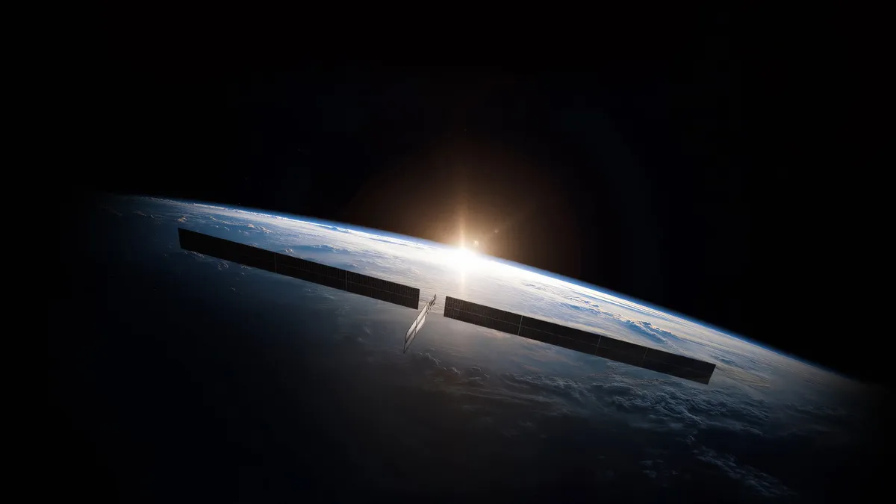

# A plain-language tour (no equations required)

This page explains the project for readers who are not numerical analysts: teachers,
classmates, family, anyone curious. The technical write-up is `report/report.md`;
everything there is also true here, just said with fewer symbols.

*The inspiration: orbital compute clusters that must glow their waste heat into space.
This project studies the method; it is not a tool for the company building these.*

## The problem, in one paragraph

Computers in orbit have one way to get rid of heat: glowing it away as radiation, because
there is no air in space. Engineers describe the temperature of a radiator panel as a
*field*, a temperature value at every point, and compute it by cutting the panel into
thousands of small cells and solving a large system of equations, once per scenario. That
is accurate but comparatively slow, and design work needs *thousands* of scenarios: what
if the coating glows better, what if the electronics run a different duty cycle? This
project builds a fast "stand-in" (a **surrogate**) that answers those what-ifs in a
fraction of a millisecond, and, crucially, shows how to build it so we can *trust* it.

Honesty first, though: for the small 2D panel studied here the trusted simulation itself
takes a few hundredths of a second, so nobody needs a stand-in for a single run, least of
all an operator with a data center. A stand-in earns its keep where answers are needed by
the *thousands inside a loop* (optimizing a design while heat couples to power and
structure, or sweeping uncertain inputs), or *on board the spacecraft itself*, where
there is no data center to ask. And the deepest goal of this project is knowing *when*
this compression trick is the right move at all.

## The main idea: a few shapes are enough

Solve the equations for many scenarios and stack the answers side by side, and the
solutions turn out to be surprisingly repetitive. Almost every temperature field is a mix
of a *few basic shapes*: an average shape, plus a little more of shape one, a little less
of shape two. Mathematics has a tool (the singular value decomposition, the same engine
behind image compression) that extracts those shapes automatically and even tells you how
many matter.

So instead of teaching a big neural network to predict the temperature in every one of
~1,700 cells, we teach a *tiny* network to predict a handful of mixing amounts, the
"sliders" for the few shapes, and rebuild the full picture from those. Like describing a
face as "the average face, plus 30% of variation A, minus 10% of variation B" instead of
listing every pixel.

## Why only three shapes? (the real science here)

The surprise is not that few shapes work; it is *how few*, and why. Three things
conspire. First, the heater never moves: the patterns of warm and cool are set by the
geometry, and turning the knobs mostly changes *how much* of each pattern appears, not
the patterns themselves. Second, two of the knobs are secretly one: doubling the heater's
power while doubling the panel's conductivity leaves the shape of the answer unchanged
(only their ratio matters), so the problem has fewer effective inputs than it appears to.
We predicted this on paper and then tested it: adding conductivity as a "new" input added
exactly zero new shapes, where naive counting says it must add one. Third, and this part
was measured rather than assumed: about a dozen spatial patterns do respond to the knobs,
but their responses follow only *two independent control curves*, and that
near-duplication is what sets precisely how tiny the third shape's leftover is (the same
calculation reproduces the measured leftover across seven different test configurations
to about 25%). One of our advance predictions missed (how the leftover shrinks as the
knob ranges narrow), and we report the miss. The technical version, with the
pre-registered predictions and the scorecard, is [notes/rank-note.md](notes/rank-note.md).

## What we found

- **When the heater stays in one place, three shapes are enough**, to within computer
  precision, even though the radiation physics is strongly nonlinear (heat loss grows
  with the fourth power of temperature). All the hard nonlinearity hides in *how much* of
  each shape you need, which is exactly the part the little network learns. We checked
  this is not an accident of the computational grid by repeating it on a finer grid and
  with a different element type.
- **When the electronics blink on and off** like a satellite's duty cycle, the changing
  fields need more shapes (roughly 6 to 12), and the surrogate has to track time too.
- **The pay-off test:** we asked both the slow, trusted simulator and the fast surrogate
  the same engineering question, across 100 combinations of coating and duty cycle: which
  design keeps the chip coolest? They returned essentially the same ranking (rank
  agreement 0.999, checked at two different operating points), the same best design, and
  the surrogate was hundreds to thousands of times faster. That makes it a *design tool*,
  not just a demo.
- **It fits where a data center does not.** The stand-in is about 8,600 numbers in total,
  and it works identically in the lower-precision arithmetic small onboard processors
  prefer (32-bit indistinguishable from 64-bit). It also turns uncertainty studies from
  an overnight batch into seconds: a hundred thousand randomly drawn scenarios propagated
  in about seven seconds, checked against ten thousand exact simulations at every
  percentile we report.

## Why you can trust the numbers

- **Known answers first.** Before any machine learning, the simulator is checked against
  problems whose exact answer we know on paper, and its error shrinks at exactly the
  textbook rate when the grid is refined.
- **Energy bookkeeping.** Watts in must equal watts out; our simulations balance to about
  one part in a hundred billion.
- **No cherry-picking.** Every number is regenerated by numbered scripts anyone can run;
  networks were retrained from twenty random starting points and we report the spread; and
  we state plainly where the surrogate fails (step outside the range it was trained on
  and errors grow about seventeen-fold).
- **Automatic re-checking.** A test suite with dozens of checks runs on every change.
- **Nothing hangs on arbitrary choices.** We also checked that the answers do not depend
  on how fine the simulation grid is (the grid's own error in peak temperature is
  hundredths of a kelvin, hundreds of times below the surrogate's), on the computer's
  arithmetic precision (32-bit is indistinguishable from 64-bit), or on luck in the
  uncertain inputs (many thousands of randomly drawn scenarios pushed through the
  surrogate match exact simulations at every percentile we report).

## What this does *not* claim

The panel is a 2D rectangle, the geometry never changes, and the surrogate is only
trustworthy inside the range of scenarios it saw during training. This is a carefully
controlled prototype that demonstrates a principle, not a certified spacecraft tool.

## Tiny glossary

- **PDE (partial differential equation):** the mathematical rulebook saying how heat
  spreads.
- **Full-order model (FOM):** the slow, trusted, cell-by-cell simulation.
- **Surrogate:** the fast stand-in trained to imitate it.
- **POD / reduced basis:** the automatically-found "few basic shapes".
- **Coefficients:** the slider positions saying how much of each shape to mix in.
- **Residual:** plug an answer back into the rulebook and measure how badly it disobeys;
  small residual means the physics is respected.
- **Emissivity (ε):** how good a surface is at glowing heat away (0 = mirror, 1 = perfect
  radiator).
- **Duty cycle:** the fraction of time the electronics are switched on.

*The original linear-plate study this grew out of lives at
[TommyDanMa/afw](https://github.com/TommyDanMa/afw), with its own plain-language tour.*
