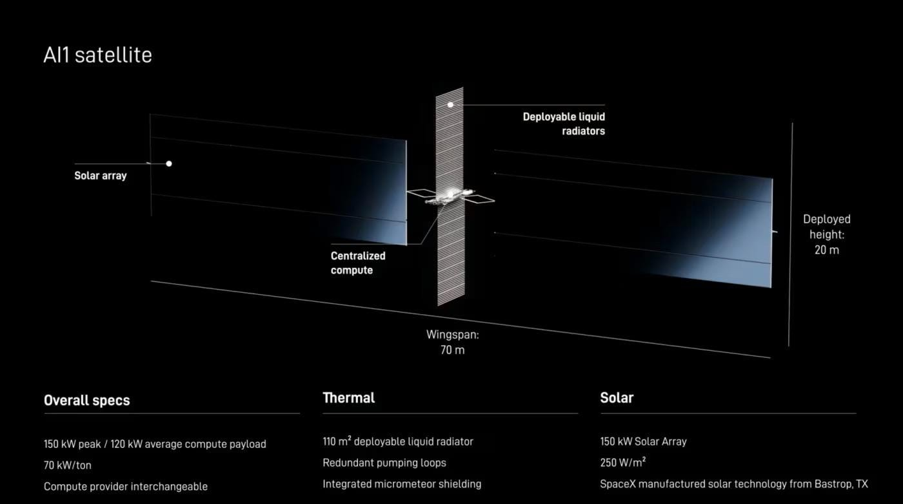
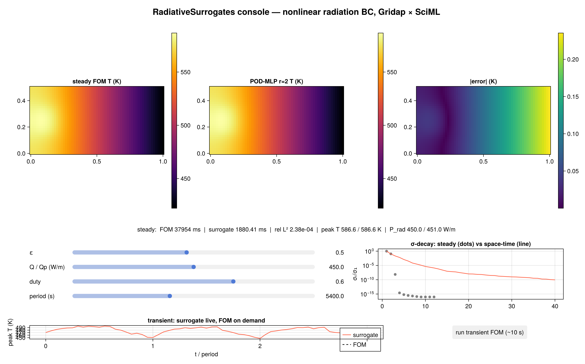
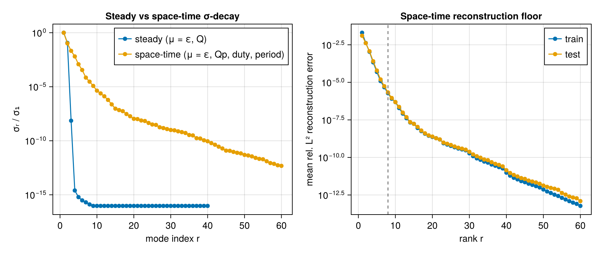
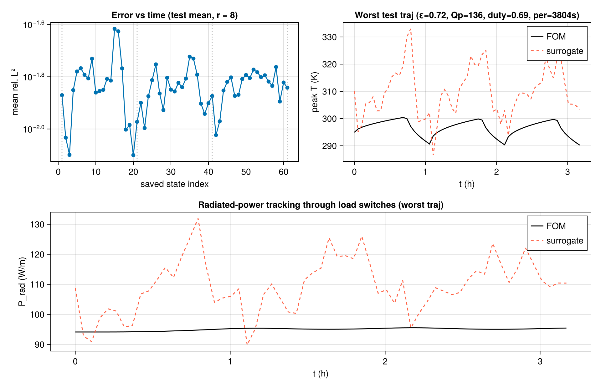
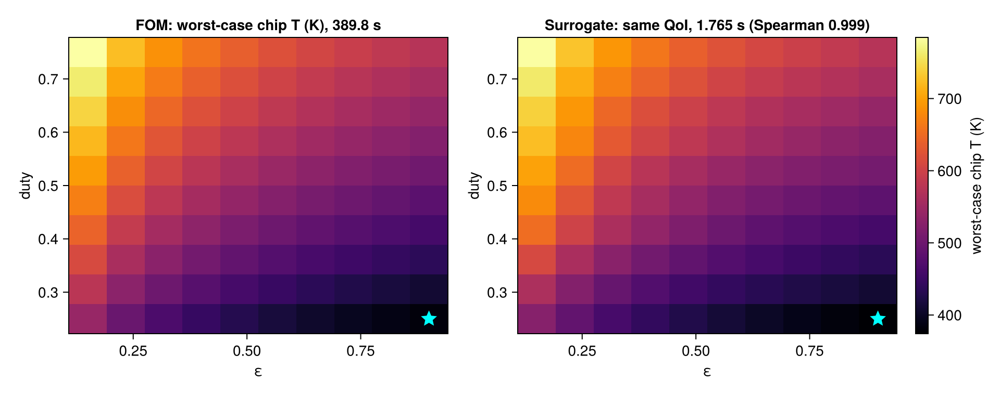
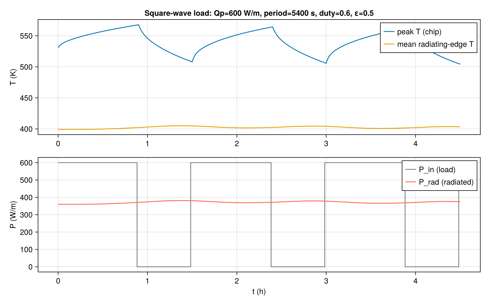

# RadiativeSurrogates: reduced-basis neural surrogates with a nonlinear radiation boundary condition

[](https://github.com/TommyDanMa/RadiativeSurrogates.jl/actions/workflows/ci.yml)
[](https://github.com/SciML/ColPrac)
[](https://github.com/SciML/SciMLStyle)

*(Non-specialists: start with [EXPLAINER.md](EXPLAINER.md), a plain-language tour.)*

This project grew out of [TommyDanMa/reduced-basis-neural-surrogates](https://github.com/TommyDanMa/reduced-basis-neural-surrogates), where the
independent, collaborative linear-elliptic reduced-basis study lives (it was not a Treball de Recerca); this repo is the
standalone continuation. The problem: the heat equation on a 2D radiator section whose
dominant heat rejection is **Stefan–Boltzmann radiation to deep space** (T_space = 3 K),
with parametric emissivity ε and electronics load cycles, a controlled prototype for
AI1-class orbital-compute thermal design (`docs/src/assets/`). **Gridap assembles, SciML
solves**: Gridap.jl builds the FE residual/Jacobian, NonlinearSolve.jl drives the steady
Newton solves, OrdinaryDiffEq.jl (mass-matrix ImplicitEuler/Trapezoid/FBDF) drives the
transients.



*The inspiration: AI1-class orbital compute (SpaceX reveal, June 2026). Its spec numbers
set our parameter regime; this prototype is a methods study, not their tool.*

**TL;DR**
- **Question:** does "learn the POD coefficients, not the field" survive a strongly
  nonlinear boundary condition, and what does the radiation regime do to the rank?
- **Core result:** for fixed load geometry the *steady* manifold is numerically **rank 3**
  (σ₃/σ₁ ≈ 7e-9); on this fixed-geometry box, the measured nonlinear variation is
  represented through the coefficient map c(μ). A whitened 8.6k-parameter MLP hits
  9.2e-4 relative L² (PDE residual 6.5e-3 vs **38.7** for a direct field MLP) at
  ~5,300× single-query / ~8,900× batched throughput over the 23 ms Newton FOM.
  Load-cycle *transients* re-thicken the manifold (σ₈/σ₁ ≈ 3e-5 vs the steady cliff),
  and the (μ, t) ↦ c surrogate reaches 1.5–1.7% on raw trajectories, 4,670× above the
  exact-Galerkin dynamics floor of 3.7e-6 at the same rank (report §8.4), yet reproduces
  full-order **design rankings** on a 10×10 (ε, duty) grid: Spearman 0.999, top-5 overlap
  5/5, identical optimum, QoI error median 2.4 K on a 382–785 K range, 221× end-to-end
  (≈8,100× warm), replicated at a second operating point (Spearman 0.9988).
- **Why it matters:** not as a substitute for one 23 ms solve. The primary result is the
  *diagnostic*: when coefficient learning is the right factorization and where its error
  lives ([notes/rank-note.md](notes/rank-note.md)). The many-query and deployment studies
  test consequences of that factorization: 10⁵ surrogate scenarios run in ~7 s with
  paired FOM quantile checks (report A.5), and the 8.6k-parameter inference pipeline is
  Float32-lossless with an explicit validity guard (report A.3). These measurements do
  not claim that the small FOM is infeasible on a particular target.
- **Main caveat:** 2D, fixed load geometry, unity view factor, in-distribution queries:
  a controlled prototype, not a general theorem. The rank-3 collapse is a property of the
  tested fixed-geometry problem and should not be attributed to radiation physics alone.

## Quickstart

```bash
julia --project=. -e 'using Pkg; Pkg.instantiate()'
julia --project=. test/runtests.jl              # test suite (CI runs this too)
julia --project=. scripts/00_run_all.jl         # full reproduction, ~2 h
# or step through scripts/01 ... 30 individually; the live console:
julia --project=. scripts/14_run_console.jl
```

`scripts/18_report_numbers.jl` reprints every headline table straight from `data/*.jld2`,
so the report can always be diffed against the data. Programmatic queries outside the
training box should check `in_training_box(ε, Q)`; measured out-of-distribution
degradation is in report appendix A.1.

**The two-page technical note** distilling the project's core finding is
[notes/rank-note.md](notes/rank-note.md): a predictive argument for why the steady
manifold is rank three, with pre-registered tests (a second heater adds one dominant mode;
conductivity adds no strong mode where naive parameter counting predicts one; the
box-scaling prediction missed, and the miss is reported), plus the exact-Galerkin error
decomposition showing that 100.00% of the deployed surrogate's error is coefficient-map
error at r = 2.

The console solves the steady FOM live while you drag ε and Q (a ~23 ms Newton solve is
interactive), next to the surrogate, the error field, QoI readouts and both σ-spectra; the
transient panel updates the surrogate's peak-T trace instantly, with the true FOM one
button-press away:



## Layout

- `src/`: `physics.jl` (weak forms, u|u|³ radiation term), `fom_steady.jl`
  (Gridap→NonlinearSolve glue, warm starts, residual traces), `fom_transient.jl`
  (mass-matrix ODE form, square-wave loads via `tstops`), `postprocess.jl` (radiated power,
  peak T, energy balance), plus `pod.jl` / `models.jl` / `metrics.jl` ported from the parent
  project (`models_kan.jl` / `models_deeponet.jl` stay out of the core module).
- `scripts/01–30`: numbered, deterministic (StableRNGs + Sobol): validate steady, steady
  dataset/POD/mappers/eval/benchmark, validate transient, transient dataset/space-time
  POD/mapper/eval, Nr study, design study, console (01–14); robustness, grid
  independence, mapper diagnostics, rank predictions, statistics, Galerkin floor,
  eigenmode diagnostic, cliff reconstruction (15–23); V&V tightening: GCI error bars,
  precision audit, attractor check, forward UQ (24–27); pre-registered
  operator-learning baseline, DeepONet (28), and its small-M probe (29); transient
  Galerkin floor (30). `18_report_numbers.jl` reprints
  every headline table from `data/`.
- `test/`: eight named test files (51 assertions): MMS rates 1.9996/1.9999/2.0000 through
  the nonlinear BC, AD = FD = hand-written Jacobian, exact discrete energy balance,
  θ-family dt-orders 0.95–0.98 / 2.08–2.00, nodally exact 1D radiative equilibrium, plus
  two skip-guarded regression files (the deployed surrogates pinned with 3× margin; the
  exact-Galerkin transient rollout of scripts/30), 20 more assertions with `data/`
  present, 71 in total.
- `report/report.md`: the write-up, figures included; `figures/`: all generated figures.

## Headline (steady, held-out; deployed rank r = 2, pinned by the rank sweep)

| model | rel L² | PDE residual ‖R(û)‖/‖F‖ | params | single× | batched× |
| --- | ---: | ---: | ---: | ---: | ---: |
| direct MLP | 5.8e-3 | 3.9e+1 | 131,427 | 1,796× | 7,259× |
| **POD-MLP** | **9.2e-4** | **6.5e-3** | 8,642 | 5,270× | 8,852× |
| POD-KAN | 2.9e-3 | 2.1e-2 | **880** | 4,159× | 9,104× |

POD floor at r=2: 1.1e-9 (basis ≠ bottleneck). Speed-ups: single-query latency and batched throughput relative to FOM Newton
solves (23.1 ms median), incl. reconstruction, excl. plotting/model loading, after warm-up
(BenchmarkTools medians, batch = 102). Hardware for all timings: AMD Ryzen AI 9 HX 370
(CPU only), 1 Julia thread, 12 BLAS threads, Julia 1.12.6. Coefficients are trained **whitened**; the rank cliff gives c a ~1e9
dynamic range. Robustness (report A.1; N = 20 fresh seeds varying network init only):
POD-MLP 1.35e-3 ± 0.18e-3 (the deployed 9.2e-4 sits at the favourable edge of the
ensemble), POD-KAN 2.86e-3 ± 0.49e-3, transient 1.89e-2 ± 0.20e-2; the rank-3 cliff
replicates at 120×60 and with P2
elements; out-of-distribution the median error grows ~17× just outside the box, so queries
should stay inside `in_training_box`.

Operator-learning baseline, pre-registered and run (scripts/28; DeepONet via
NeuralOperators.jl, equal 8,656-parameter and 3× budgets, matched data-only training,
N = 20 seeds/arm):
competitive on rel L² (3.3e-3) but 283× worse on PDE residual (1.85 vs 6.5e-3); with
the trunk frozen to the POD basis the residual gap collapses 15×, so the learned basis
is a material contributor under matched field loss and parameter budget. Two of four
registered predictions missed and are reported as misses (report §7.4).

New in the V&V pass (report appendix A): forward UQ through the surrogate (N = 10⁵ in
~7 s) matches an exact 10⁴-solve FOM Monte Carlo within 0.71 K at every reported
quantile; Float32 inference is lossless at reported precision (Float16 physics
evaluation overflows: u⁴); GCI bands the deployed grid's own QoI discretization error at
≤ 0.01 K (observed orders 1.99–2.00); and a 20-cycle FOM run verifies the settled-cycle
deployment contract (per-cycle deviation flat within 1.41×; the τ > 1 region stays OOD
and guarded).

## Key figures



*The project's keystone: the steady rank-3 cliff against the rich space-time spectrum.
Fixed load geometry collapses the steady manifold; switching transients re-thicken it.*



*Radiated-power tracking through load switches, surrogate vs FOM, shown for the worst
held-out trajectory.*



*The (ε, duty) design-ranking grid: worst-case chip temperature, FOM vs surrogate,
Spearman 0.999 with the same optimum (star).*



*The radiator's thermal inertia filters a 0↔600 W square wave down to a ~20 W ripple in
radiated power while the chip sawtooths over ~60 K.*

Relationship to the parent project: this executes its §11 "Gridap.jl FEM" future-work item,
keeps its conventions (numbered scripts, MMS acceptance band, fully specified benchmark
captions), and drops one of its claims explicitly: with a radiation BC there is no
"exact BC by construction", so QoI fidelity (radiated power, peak temperature) takes
that role.

## Contributions, assistance, and investigation status

Tommy proposed the idea and selected the tools and general technical direction.
His father contributed software-development expertise and coordinated much of the
implementation using Claude Code. Tommy studied the mathematical formulation,
source code, numerical methods and results, and investigated the surrogate behavior
in technical discussions. This does not claim that he independently implemented
the initial software or designed and executed every recorded experiment.
Chris Rackauckas reviewed and discussed the project with Tommy and suggested further
directions; he was not a formal research supervisor, coauthor or institutional sponsor.
External methods and software are referenced in `paper/paper.bib`, the report, and
`Project.toml`. Codex assisted with November 2026 factual documentation corrections.

The completed recorded studies through script 30 include the comparison of learned
transient coefficients with reduced physical dynamics. At the tested settings,
adding modes alone does not remove the prediction error; the exact-Galerkin comparison
helps separate representation error from coefficient/dynamics prediction error.
This is a conclusion about these experiments, not a theorem about all surrogates.
Scripts 31–33 explore operator inference and latent dynamics; their presence does
not establish a completed, validated latent-ODE result. These investigations remain
unfinished. `paper/paper.md` is an unsubmitted draft with unresolved author metadata,
not a publication or a reliable statement of sole software authorship; use this
contribution disclosure when describing the project.

## Demonstration prerequisites

The console (`scripts/14_run_console.jl`) needs an OpenGL display and existing
`data/` POD and trained-model artifacts; these are git-ignored and are **not included
in a fresh clone**. `CONSOLE_SMOKE=1 julia --project=. scripts/14_run_console.jl`
uses CairoMakie for a headless check but still requires those artifacts.
`scripts/18_report_numbers.jl` also needs existing `data/*.jld2`; it cannot verify
headline numbers from the public clone alone. Do not launch the full two-hour
pipeline for a short demonstration. Existing PNG figures are static evidence, not
a substitute for an accessible working demo. The core tests can run without cached
training artifacts; the artifact-dependent regression tests are then skipped.
All benchmark and scientific headline values above are reports of existing runs,
not independently reproduced measurements from the November 2026 portfolio review.
