# When Is Coefficient Learning the Right Factorization?

**A diagnostic study of reduced-basis neural surrogates for the heat equation with a
nonlinear radiation boundary condition**

*A Gridap × SciML prototype for orbital compute thermal design.*

## Abstract

This report asks when learning reduced-basis coefficients ($\mu \mapsto c$, never the
full field) is the right factorization for a neural surrogate, and answers it twice on
one problem: the heat equation on a 2D radiator section rejecting heat by
Stefan–Boltzmann radiation to deep space ($T_\text{space} = 3\,$K), with parametric
emissivity and electronics load cycles. **Steady case: yes, and provably map-limited.**
For fixed load geometry the solution manifold is numerically **rank 3**
($\sigma_3/\sigma_1 \approx 7\cdot10^{-9}$, grid- and element-independent): the
parameters move temperature levels and amplitudes of essentially fixed spatial shapes,
so all of the problem's strong nonlinearity lives in the coefficient map $c(\mu)$. Two
exact parameter collapses and a measured functional collinearity explain the collapse;
of three predictions pre-registered to test the explanation, two hit (a second heater
adds exactly one mode; conductivity as a third parameter adds none, against naive
parameter counting) and one missed (box-shrink scaling), the miss leading to the
collinearity mechanism that reconstructs the cliff to ~25% across seven configurations.
An exact reduced-Galerkin floor certifies the architecture: at the deployed rank,
100% of the surrogate's error is coefficient-map error, and an 8,642-parameter
whitened MLP reaches $9.2\cdot10^{-4}$ relative $L^2$ with a PDE residual ~6,000×
smaller than a direct field MLP's, at thousands of times the FOM's throughput. A
pre-registered operator-learning baseline (DeepONet, matched budgets and data) is
competitive in $L^2$ but 283× worse in PDE residual; freezing its trunk to the POD
basis collapses the gap 15×, locating the physics in the basis.
**Transient case: not yet, for a measured reason.** Load switching re-thickens the
manifold ($\sigma_8/\sigma_1 \approx 3\cdot10^{-5}$); the $(\mu, t) \mapsto c$ mapper
plateaus at 1.7%, and its learning curve (slopes 0.82/1.10) shows the plateau is
data-limited, pointing to latent dynamics rather than more modes. The plateaued
surrogate still reproduces full-order design rankings (Spearman 0.9987/0.9988 at two
operating points, top-5 5/5, identical optimum). A controlled 2D prototype, not a
general theorem; the verification machinery lives in Appendix A.

## 1. The question

For fixed load geometry, the steady manifold of the heat equation with a
Stefan–Boltzmann $u^4$ boundary is numerically rank 3: $\sigma_3/\sigma_1 =
7.2\cdot10^{-9}$ over 410 solutions whose peak temperatures span 296–973 K, and the
number survives grid and element refinement (§4). Nothing in the problem statement announces it.

Everything else in this report hangs on that observation. Reduced-basis surrogates
learn $r$ coefficients instead of $n$ field values; whether that factorization is
sound rests on exactly the manifold dimension that is usually assumed rather than
measured. Here it
is measured, explained, and relied on: §5 explains the collapse (two exact parameter
collapses, a measured functional collinearity); §6 tests the explanation with
predictions pre-registered before the scripts ran, two hits and one recorded miss; §7
draws the consequence, an exact Galerkin floor certifying that 100% of the deployed
surrogate's error is coefficient-map error, none of it basis.

A diagnostic earns the name only if it can say no. The transient problem supplies the
no: load switching re-thickens the manifold ($\sigma_8/\sigma_1 \approx 3\cdot10^{-5}$),
the $(\mu, t) \mapsto c$ mapper plateaus at 1.7%, and its learning curve pins the
plateau on data, not on the basis (§8). Opposite verdicts on the same physics, solver,
and pipeline, each confirmed downstream. The test:

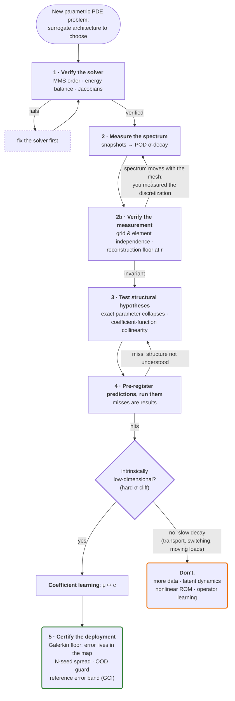

*The diagnostic this report walks, twice. Every box is a numbered artifact in this
repository: box 1 is the test suite (§3); 2 and 2b are the snapshot POD and its grid- and
element-independence check (§4); 3 is the parameter collapses and the collinearity
measurement (§§5–6); 4 is the pre-registered score card (§6); 5 is the Galerkin floor and
the deployment contract (§7, §9.3). The steady problem exits through the yes-branch, the
transient problem through the no-branch (§8); §9 collects the engineering consequences,
and the verification machinery sits in Appendix A.*

**Physical motivation.** In vacuum heat leaves only by radiation. The concrete prompt
is AI1-class orbital compute (SpaceX reveal, June 2026; see `docs/src/assets/`):
150 kW-peak compute through ~110 m² of deployable radiators, about 1.4 kW/m², which
our parameter regime brackets; the spec numbers are motivation, not model inputs. One
origin note, for honesty: the first candidate testbed was Maxwell's equations; the
radiation BC was chosen instead as a far simpler carrier of strong nonlinearity, one
boundary term with everything else linear, which is what keeps the diagnostic
controlled.

**Who actually needs the surrogate.** Not a design office with abundant compute: it
runs the 23 ms FOM (§9.1) and has its answer over a coffee. The class pays in
*many-query outer loops*, where optimization and uncertainty propagation ask for
$10^4$–$10^6$ evaluations (100,000 scenarios in 7.5 s against 444 s for a tenth as
many by FOM; §9.3, A.5); in *onboard and edge deployment*, where an 8,642-parameter,
Float32-lossless model with an explicit `in_training_box` guard fits hardware the FOM
never will (A.3); and, first among the three, in the *diagnostic itself*
(`notes/rank-note.md`).

## 2. The problem

Strong form on $\Omega = (0,1) \times (0,0.5)$ m:

$$\rho c\, \partial_t u = \nabla\!\cdot\!(k \nabla u) + q(x;\mu,t), \qquad
-k\,\partial_n u = \varepsilon(\mu)\,\sigma\,(u^4 - T_\text{space}^4) \ \text{on } \Gamma_r,$$

with the remaining edges insulated (canonical config B) and the steady problem obtained by
dropping the time term. In code the radiation nonlinearity is written $u|u|^3 - T_s^4$: it
coincides with $u^4 - T_s^4$ for $u > 0$ and is monotone on all of $\mathbb{R}$, so Newton
iterates that momentarily dip negative still feel a restoring flux of the correct sign.

Two structural facts drive the verification suite. First, with no Dirichlet DOFs the constant
$v \equiv 1$ lies in the test space, so the solved discrete system satisfies the **exact
discrete energy balance** $P_\text{in} = \oint \varepsilon\sigma (u_h^4 - T_s^4)\,d\Gamma$ up
to the Newton tolerance. Second, the boundary Jacobian is analytic,
$4\varepsilon\sigma|u|^3$ on $\Gamma_r$, giving a hand-written matrix to check the assembled
AD Jacobian against. The dimensionless **radiation number** $\mathrm{Nr} = \varepsilon\sigma
T^3 L / k$ measures how strongly radiation couples relative to conduction; over our parameter
box it spans roughly 0.05–1.5.

POD/SVD compression is inherited verbatim from the parent project (plain $\ell^2$ inner
product on the uniform grid; Eckart–Young optimality; mass-weighted POD remains future work).
One honest difference: the parent's "reconstructions satisfy the BCs exactly by construction"
selling point does **not** carry over, since the radiation BC is part of the residual. QoI
fidelity (radiated power, peak temperature) takes over that role.

## 3. A verified solver

The FE machinery is [Gridap.jl](https://github.com/gridap/Gridap.jl): a
`CartesianDiscreteModel` (default 60×30, P1 Lagrangian; element order is a config knob), the
weak residual

$$R(u; v) = \int_\Omega k \nabla v \cdot \nabla u \; - \int_\Omega v\, q
\; + \oint_{\Gamma_r} v\, \varepsilon\sigma\,(u|u|^3 - T_s^4),$$

boundary quadrature of degree 6 (the $v\,u^4$ integrand is degree 5 for P1), and Gridap's
autodiff for the Jacobian. Everything downstream of assembly is the SciML stack:

- **Steady:** the algebraic operator is wrapped as a `NonlinearFunction` (in-place residual
  and Jacobian, sparse `jac_prototype`) and solved by `NonlinearSolve.NewtonRaphson`,
  warm-started along parameter sweeps and initialised at the analytic radiative-equilibrium
  temperature $(Q/(\varepsilon\sigma|\Gamma_r|) + T_s^4)^{1/4}$. Every residual evaluation is
  logged, so Newton traces are first-class artifacts.
- **Transient:** method of lines, $M \dot u = -R_\text{space}(u) + Q(t) F_\text{unit}$, with
  the consistent $\int \rho c\, u v$ mass matrix, integrated by OrdinaryDiffEq mass-matrix
  methods: `ImplicitEuler` and `Trapezoid` (the θ-family the scope document asked for), plus
  adaptive `FBDF` for production runs. Square-wave load switches are passed as `tstops`, so
  discontinuities are hit exactly rather than smeared.

This division of labour is the point of the architecture. "Residuals and Jacobians under
control" means we hand the *assembled* $R$ and $J$ to the solver ourselves, and can therefore
test them independently of any solver behaviour.

Eight named test files (51 assertions) pin the physics before any ML enters, plus a
skip-guarded regression file (17 more whenever the data artifacts are present, 68 in
total) that pins the *deployed* surrogates' quality with 3× margin:

| Test | What it pins | Result |
| --- | --- | --- |
| `test_steady_solver` | tags/geometry, ε=0 linear limit vs direct sparse solve, NewtonRaphson vs TrustRegion, warm starts | pass (agreement ≤ 1e-9) |
| `test_jacobian` | AD Jacobian vs central FD in random directions; vs hand-written $A_\text{cond} + 4\varepsilon\sigma|u|^3$ boundary block | pass (≤ 1e-6 / 1e-9 rel) |
| `test_energy_balance` | exact discrete balance (config B); reaction-recovered wall influx (config A) | rel ≤ 1e-8 (measured ~1e-10) |
| `test_manufactured_solution` | MMS **through the nonlinear BC** (inhomogeneous radiation data), P1 L² order 2, band [1.7, 2.2] | rates **1.9996, 1.9999, 2.0000** |
| `test_analytic_equilibrium` | closed-form 1D profile $u_1 = (q_0 L/\varepsilon\sigma + T_s^4)^{1/4}$ | nodally exact (2.6e-12 K) |
| `test_transient` | steady long-time limit; fixed-Δt orders vs tight FBDF reference; energy bookkeeping $\Delta E = \int (P_\text{in} - P_\text{rad})$ | BE rates 0.95–0.98, CN 2.08–2.00; bookkeeping < 1% |
| `test_pod_models` | POD orthonormality/round-trip, mapper shapes, determinism, trainability | pass |

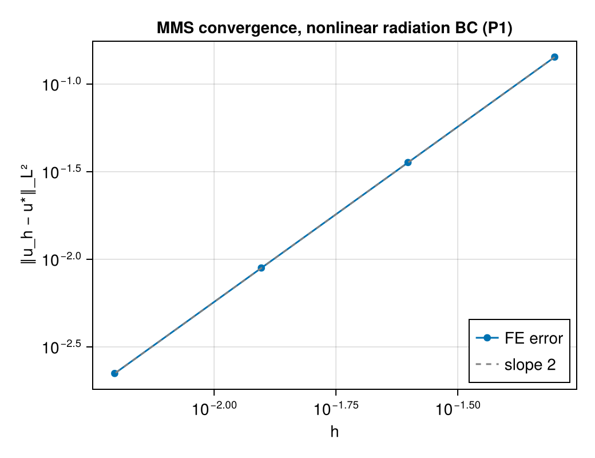
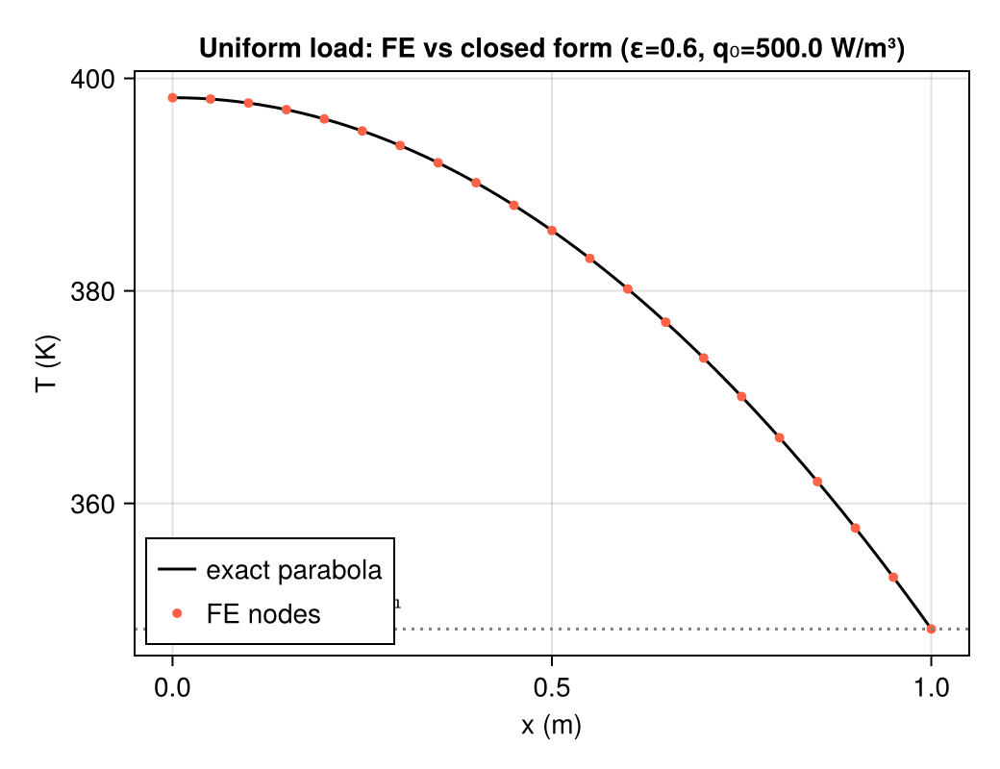

The time integrators get the same treatment. Fixed-Δt convergence against a tight FBDF
reference (smooth sinusoidal load): ImplicitEuler rates 0.954/0.967/0.980, Trapezoid
2.077/2.017/2.004; the θ-family behaves exactly as advertised through the nonlinear
boundary term, and long-horizon constant-load runs reproduce the steady solution to the
integrator tolerance.

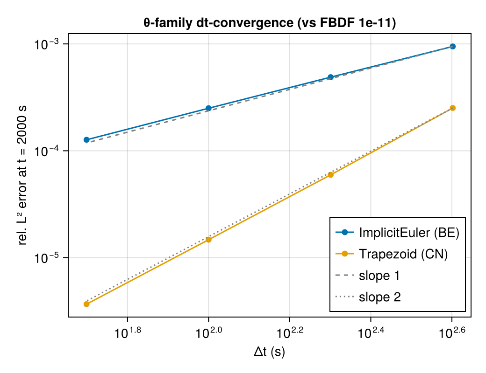

Two details are worth recording. The 1D uniform-load test is *nodally exact* (P1 nodal
superconvergence via the piecewise-linear Green's function), a far stronger check than the
intended $O(h^2)$ tolerance. And all energy bookkeeping must use the *discretely injected*
power $Q \cdot \int \hat q\, d\Omega_h$: on grids where the chip patch does not align with
cell faces the quadrature captures only part of the nominal $Q$, and the discrete system
conserves the quadratured value, not the nominal one.

## 4. The observation: a rank-3 manifold

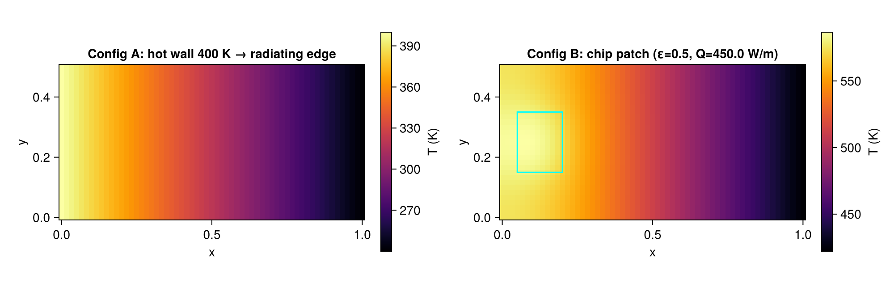

512 Sobol samples over $\mu = (\varepsilon, Q) \in [0.1, 0.95] \times [100, 800]$ W/m, one
converged Newton solve each (median 49 ms as logged by the machine that generated the
frozen dataset, 23.1 ms re-measured on the current hardware, §9.1; worst energy balance
6e-12, peak temperatures 296–973 K). The POD of the 410 training snapshots delivers the
observation the rest of the report answers to:

| $r$ | $\sigma_r/\sigma_1$ | reconstruction error (test) |
| ---: | ---: | ---: |
| 1 | 1 | 1.1e-1 |
| 2 | 1.15e-1 | **1.1e-9** |
| 3 | 7.2e-9 | 6.2e-16 |
| 5 | 6.1e-16 | 1.8e-16 |

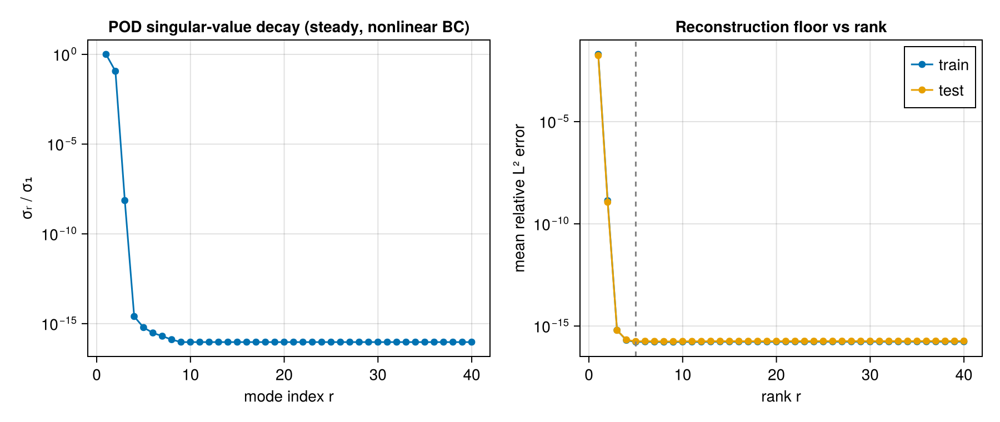

**The steady manifold is numerically rank three** (and rank *two* for every practical
purpose): two modes reconstruct held-out fields to 1.1e-9, and the third singular value
already sits eight orders below the first.

The measurement itself is verified before it is interpreted (the flowchart's box 2b).
The collapse is not a discretization artifact: replicating the POD on a 2× finer grid
gives $\sigma_3/\sigma_1 = 6.7\cdot10^{-9}$ (120×60, P1) and with quadratic elements
$6.8\cdot10^{-9}$ (60×30, P2), against $7.2\cdot10^{-9}$ at the baseline
(`scripts/16_grid_independence.jl`). The spectrum is a property of the solution
manifold, not of the mesh.

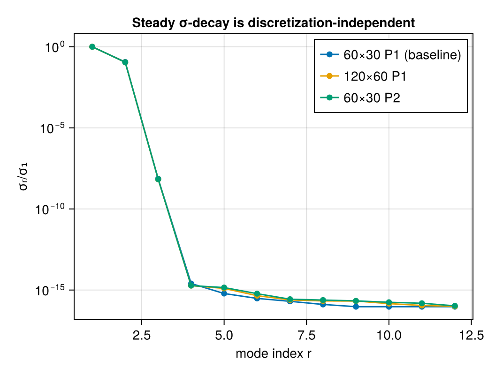

Nothing in the problem statement announces this. The box spans temperatures from 296 to
973 K, the boundary term is quartic, and a two-parameter problem could plausibly fill
many directions. It does not. That demands an explanation, and the explanation had
better predict something.

## 5. Candidate explanation

Three structural facts, in increasing order of what they explain.

**Exact parameter collapses.** The interior equation is linear: each fixed load shape
contributes one exact manifold direction, scaled by its amplitude, and $(Q, k)$ enter
the particular solution only through $Q/k$. Together with the boundary condition, the
solution depends on $(\varepsilon, Q, k)$ only through $(Q/k, \varepsilon/k)$: the
*effective* parameter count is two, whatever the nominal count is. The harmonic
remainder, driven by near-uniform radiating-edge flux, spans very few shapes.

**Analyticity.** The parameter-to-solution map is analytic on the box (the radiation
term is analytic and monotone in $u$), and analytic parametric maps have exponentially
decaying Kolmogorov widths; the smoothness-to-decay half of the argument is standard
(Cohen–DeVore–Schwab and successors; references at the end). This explains *fast* decay.
It does not explain where the cliff sits.

**Mechanism.** With the load geometry fixed, varying $Q$ scales the linear source-response shape exactly. Varying $\varepsilon$ moves the radiative-equilibrium level, the amplitude of the constant mode. That amplitude depends on $\varepsilon$ strongly and nonlinearly, but the shape it multiplies is fixed, and POD rank sees only shapes. So the nonlinearity lives entirely in the coefficient map $c(\mu)$, which is what a learned mapper is for.
(What re-thickens the manifold is transients, not parameters; §8.)

If this explanation is right, it predicts. Three tests were pre-registered in
`notes/rank-note.md` before `scripts/19_rank_prediction.jl` first ran:

- **P1**: a second heater patch is one new load shape, so it adds *exactly one* mode.
- **P2**: conductivity as a third parameter adds *none*, because of the $Q/k$ collapse;
  naive $d+1$ parameter counting predicts a fourth $O(\sigma_2)$ mode.
- **P3**: shrinking the parameter box shrinks $\sigma_3$ with a log–log slope in
  $[1, 2]$ (analyticity-driven decay).

## 6. The predictions: two hits, one miss, and what the miss exposed

Each prediction targets a different way the explanation could fail: P1, whether load shapes really contribute one direction each; P2, whether the $Q/k$ collapse, not the parameter count, sets the rank; P3, whether analyticity sets the *scale* of the cliff. A hit supports the mechanism; a miss localizes which part is not yet understood. Scored against `scripts/19_rank_prediction.jl`:

- **P1, hit.** The cliff moves down by exactly one mode:
  $\sigma_4/\sigma_1 = 8.3\cdot10^{-6}$.
- **P2, strong hit.** $\sigma_4/\sigma_1 = 3\cdot10^{-14}$: no fourth mode where naive
  parameter counting predicts one. The $Q/k$ collapse, not the parameter count, sets
  the rank.
- **P3, miss.** The box-shrink scaling came out sub-quadratic: fitted log–log slopes
  $0.22 \pm 0.00$ on the ε-axis and $0.66 \pm 0.01$ on the Q-axis (mean ± std over
  N = 3 independent dataset draws), against the predicted $[1, 2]$. A miss, recorded;
  too tightly replicated to be a sampling artifact.

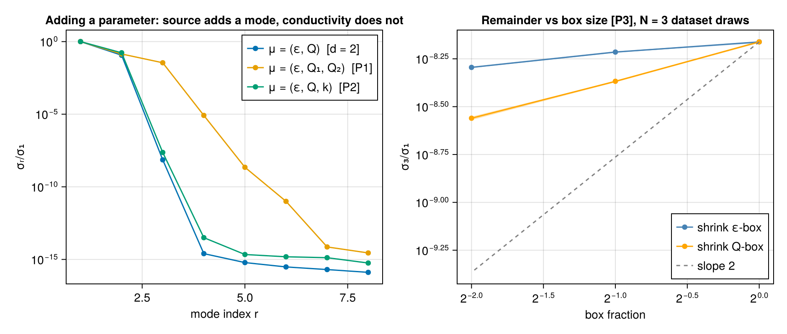

The miss says the *scale* of the cutoff was not understood, and it looped the diagnosis
back once (the flowchart's miss edge). An eigenmode diagnostic
(`scripts/22_eigenmode_diagnostic.jl`, suggested by external review, exploratory, not
pre-registered) rejects a spectral-gap explanation and localizes the cutoff in
**functional collinearity**: 12 parity-allowed eigenmodes of the linearized operator are
excited (amplitudes $\sim \lambda^{-1.9}$), but their coefficient functions over the
parameter box have normalized singular values 2.5, 2.3, 3.9e-5. Many spatial modes, two
independent parameter functions. Details in `notes/rank-note.md` §4b.

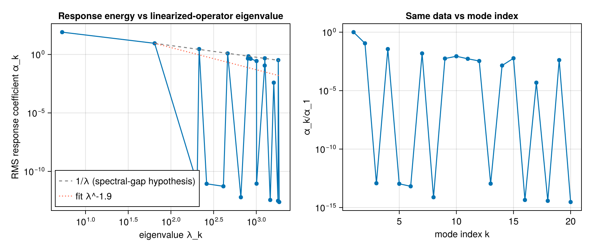

The quantitative version generalizes (`scripts/23_cliff_reconstruction.jl`): the
singular value of the amplitude-weighted excited coefficient functions reproduces the
measured POD cliff to a uniform ~25% across seven configurations (base, both
3-parameter variants with $r^*$ detected automatically, and the four shrink boxes),
while the naive leakage × total-amplitude product overpredicts by up to three orders
of magnitude (deflation matters). The cutoff scale is set by functional collinearity weighted by the amplitude
the independent direction carries; the σ-cliff measures how many independent parameter
functions drive the excited modes. Here: two.

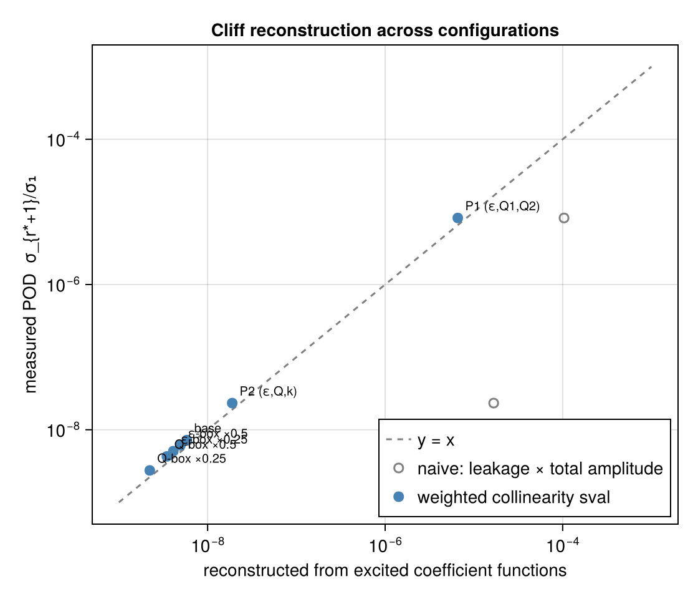

## 7. The consequence: coefficient learning, certified

### 7.1 Models and metrics

The diagnosis licenses the factorization $\hat G = R \circ N$: a fixed linear
reconstruction $R(c) = \bar u + \Phi_r c$ and a small learned map
$N: \tilde\mu \mapsto c$ (inputs standardized to $[-1,1]^d$). Three mappers are
compared: a POD-MLP (tanh, 64×3), a POD-KAN (`KolmogorovArnold.KDense`, kept as a
*compact coefficient-mapper baseline*, not a structural ingredient), and a direct MLP
$\mu \mapsto u$ baseline trained on scaled fields.

One training consequence follows directly from the rank cliff: the coefficient dynamic
range is $c_1 : c_3 \approx 10^9$, so a raw MSE loss cannot learn the small modes (their
gradients are ~$10^{-18}$). All mappers are therefore trained on **whitened
coefficients** $\tilde c_i = c_i / \mathrm{std}(c_i)$, with the scales stored in the
model file and re-applied at prediction time. The choice is load-bearing and the basis
sets the ceiling, both measured: turning whitening off (same seed) degrades the mapper
200× to 2.1e-1, and swapping in a random orthonormal basis caps accuracy at exactly its
own projection floor, 2.13e-1 (ablations in A.1).

The contrast that motivates non-intrusive reduction here: an intrusive POD-Galerkin ROM
of this problem would need a Newton solve *in the reduced space* at every query, with
the $u^4$ boundary term evaluated by hyper-reduction (DEIM/EIM) to stay independent of
$n$. The coefficient mapper sidesteps both, because the FOM's nonlinearity is baked into
the training data. The price is being purely data-fit inside the sampled box, with the
assembled nonlinear residual retained as an *a posteriori* physics check.

Metrics, per test sample: relative L² field error; coefficient error; the **nonlinear
PDE residual** $\|R(\hat u)\|_2 / \|F_\text{load}\|_2$ evaluated with the same Gridap
assembly as the solver (the honest generalization of the parent's
$\|A\hat u - b\|/\|b\|$); and two design QoIs, relative radiated-power error and
absolute peak-temperature error (K).

### 7.2 Held-out accuracy

Held-out evaluation (102 samples), deployed rank **r = 2** (pinned by the sweep below;
seeds are rank-keyed so the deployed models *are* the sweep models):

| model | rel L² | rel residual | coef err | ΔP/P | ΔT_peak (K) | params |
| --- | ---: | ---: | ---: | ---: | ---: | ---: |
| direct MLP | 5.80e-3 | **3.87e+1** | — | 1.7e-2 | 16.3 | 131,427 |
| **POD-MLP** | **9.18e-4** | **6.53e-3** | 6.2e-3 | 3.5e-3 | 3.6 | 8,642 |
| POD-KAN | 2.92e-3 | 2.09e-2 | 1.5e-2 | 1.1e-2 | 6.4 | **880** |

POD floor at r=2: rel L² 1.1e-9, residual 5.1e-7; FOM residual floor 4.2e-12. The basis sits
five to six orders below the network error; *the basis is not the bottleneck*, in an even
more extreme form than the parent project. The direct MLP's residual (38.7: its fields
violate the discretized PDE badly despite a decent L² error) is the physics-consistency gap
in one number.

Rank sweep (rel L² / residual):

| $r$ | POD-MLP | POD-KAN |
| ---: | :---: | :---: |
| 1 | 1.73e-2 / 7.41e-1 | 1.82e-2 / 7.44e-1 |
| **2** | **9.18e-4 / 6.53e-3** | 2.92e-3 / 2.09e-2 |
| 3 | 1.30e-3 / 8.93e-3 | 2.93e-3 / 1.87e-2 |
| 5 | 1.74e-3 / 1.18e-2 | 3.56e-3 / 2.27e-2 |

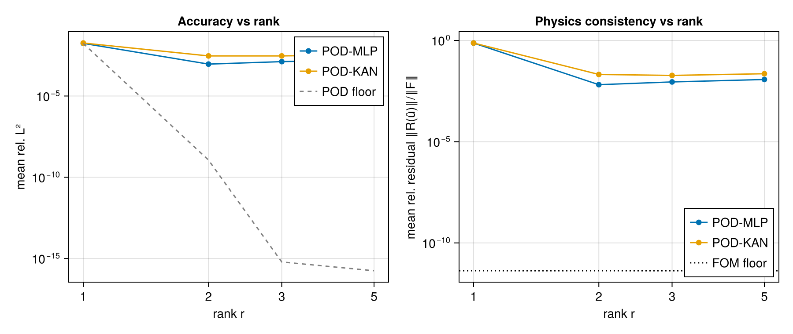
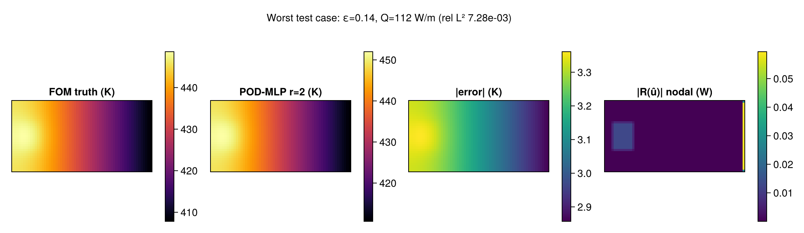

The parent's non-monotonicity lesson recurs *in extremis*: mode 3 is numerically dead
($\sigma_3/\sigma_1 \sim 10^{-8}$) and modes 4–5 are pure round-off, so ranks beyond 2 make
the network fit noise and measurably degrade both metrics. Model selection by held-out
error, not by σ-decay alone, picks r = 2.

Seed robustness, inline (full machinery in A.1): twenty fresh seeds varying the network initialization only give 1.35e-3 ± 0.18e-3, range [9.69e-4, 1.67e-3] (N = 20). The deployed model's 9.18e-4 beats all twenty: it is a favourable seed, stated plainly in A.1. What does *not* depend on the seed is every conclusion: MLP < KAN, both ≪ direct, the r = 2 optimum, all surviving all twenty. Paired bootstrap
differences on the same 102 test parameters exclude zero: KAN − MLP = +2.0e-3
[1.6, 2.4]e-3, direct − MLP = +4.9e-3 [4.4, 5.4]e-3 rel L² (B = 10,000). The ordering is
not seed luck.

### 7.3 The certificate: an exact Galerkin floor

**Error decomposition via the exact Galerkin floor** (`scripts/21_galerkin_floor.jl`).
Solving the exact reduced-Galerkin system (Newton on $\Phi_r^\top R(\bar u + \Phi_r c) =
0$; at $n = 1891$ no hyper-reduction is needed offline, DEIM being the online path) bounds
any surrogate confined to the POD subspace. Mean over the 102 test parameters:

| rank | L² projection floor | Galerkin floor | POD-MLP error | map share |
| ---: | ---: | ---: | ---: | ---: |
| 1 | 1.7e-2 | 2.4e-2 | 1.7e-2 | basis-limited |
| **2** | 1.14e-9 | **1.14e-9** | 9.2e-4 | **100%** |
| 3 | 6.2e-16 | 2.8e-13 | 1.3e-3 | 100% |
| 5 | 1.8e-16 | 2.8e-13 | 1.7e-3 | 100% |

At and above the manifold rank the Galerkin floor equals the L² projection floor to every
digit measured (table: $1.14\text{e-}9 = 1.14\text{e-}9$ at $r=2$), so none of the deployed
surrogate's error is basis error: all of it is in the coefficient map. Below it ($r=1$)
the mapper already sits at the basis floor. The crossover tells you, per rank, whether to
spend effort on the basis or on the map.

### 7.4 The registered operator-learning baseline: DeepONet (run 2026-07-11)

The protocol registered here ran with predictions D1–D4 pre-registered in the script
header before the first run and the scorecard appended after
(`scripts/28_deeponet_baseline.jl`): an operator-learning baseline, DeepONet (Lu et
al. 2021; NeuralOperators.jl v0.6.4; branch on
$\tilde\mu$, trunk on $x$, p = 8 latent functions) on the same 410 snapshots, at equal
and 3× parameter budgets, the POD-MLP's training schedule byte-for-byte (6,000
full-batch Adam epochs, geometric lr anneal, keep-best), scaled-field MSE for every
arm, N = 20 init-only seeds per arm, a trunk-frozen-to-$\Phi_2$ arm isolating
learned-basis vs fixed-basis (the POD-DeepONet configuration of Lu et al. 2022, the
operator-learning community's own fixed-basis variant), and a sample-efficiency curve
at M ∈ {102, 205, 410} (N = 5). Two predictions hit, two missed; the misses are the interesting part.

| arm | params | rel L² (N = 20) | residual ‖R(û)‖/‖F‖ (N = 20) |
| --- | ---: | ---: | ---: |
| POD-MLP r = 2 (reference) | 8,642 | 9.18e-4 deployed; 1.35e-3 ± 0.18e-3 | 6.53e-3 |
| DeepONet, equal budget | 8,656 | 3.30e-3 ± 0.50e-3 | 1.85 ± 0.28 |
| DeepONet, 3× budget | 25,936 | 2.44e-3 ± 0.33e-3 | 1.54 ± 0.17 |
| DeepONet, trunk = $\Phi_2$ | 8,642 | 1.90e-2 ± 0.04e-2 | 0.125 ± 0.004 |

The table reads as one chain. Swap one ingredient at a time and watch the residual: a
free field (the direct MLP of §7.2) sits at 38.7; sharing eight smooth learned shapes
brings it to 1.85; replacing the learned shapes with the POD basis at the same loss
brings it to 0.125; training that basis's two coefficients under the whitened loss
brings it to 6.53e-3; exact projection coefficients reach 5.1e-7 (§7.2). Shared
smoothness, then what the basis is made of, then how the coefficients are trained,
then the map error the Galerkin floor certifies (§7.3).

**D1, hit (the primary metric).** At matched everything, the equal-budget DeepONet is
283× worse on PDE residual (1.85 against 6.53e-3), and tripling the parameters buys
17%, not orders (1.54): the bottleneck is the objective, not capacity, since nothing
in a field-MSE loss asks for correct curvature. Competitive fields, violated physics:
the residual applies the assembled operator, and second differences amplify
percent-level curvature error to order one. POD modes inherit the curvature of the
solutions they combine; a tanh trunk's shapes do not. The direct-MLP lesson of §7.2
recurs one level up, softened but not removed by the shared-basis structure
(38.7 → 1.85).

**D2, hit.** Rel L² 3.30e-3, 2.4× the POD-MLP ensemble mean: competitive on the metric
DeepONet optimizes.

**D3, miss.** The frozen-trunk arm was registered to land within 3× of the POD-MLP's
residual; it landed at 19× (0.125). The bound was mis-derived, not the physics: it
ignored the loss-weighting effect A.1 had already measured (field MSE under-weights
mode 2 by $(\sigma_1/\sigma_2)^2 \approx 76$; the frozen arm's 158.4 K peak-temperature
error is that effect expressed in a QoI). Recorded as a miss regardless. The clause
that carries information held: same loss, same budget, the POD trunk beats the learned
trunk by 14.9× on residual; the learned basis carries the physics gap. The two metrics
rank arms 1 and 3 in opposite orders (rel L² 3.30e-3 vs 1.90e-2): eight co-adapted
shapes bend to wherever the L² fit is easiest, two frozen shapes have nowhere to hide
an under-trained mode 2. Basis and loss fail separately; the POD-MLP is the arm that
gets both right.

**D4, miss; the frame was wrong, not the numbers.** Registered: DeepONet degrades more
than the POD-MLP as the training set drops 410 → 102. Measured: DeepONet barely moves
(4.36 → 3.29 → 3.67e-3 across M, flat within seed noise) while the POD-MLP converts
data into accuracy (2.09 → 1.46 → 1.43e-3). DeepONet is not data-hungry here; it is
*saturated* at an architecture-set floor that more data cannot buy through. Within the
measured range the POD-MLP leads at every M (2.1–2.6×). Below M = 102 a registered
probe (M ∈ {13, 26, 51}, N = 5; `scripts/29`) came back inconclusive by its own
registered criterion: the two methods are indistinguishable there, both data-limited;
no direction is claimed. "Worse sample efficiency" mispredicted the direction of the phenomenon: at
larger M the gap widens. Read fairly, the flat curve is also a strength: the DeepONet
reaches its own floor with a quarter of the data; what it pays is the height of that
floor.

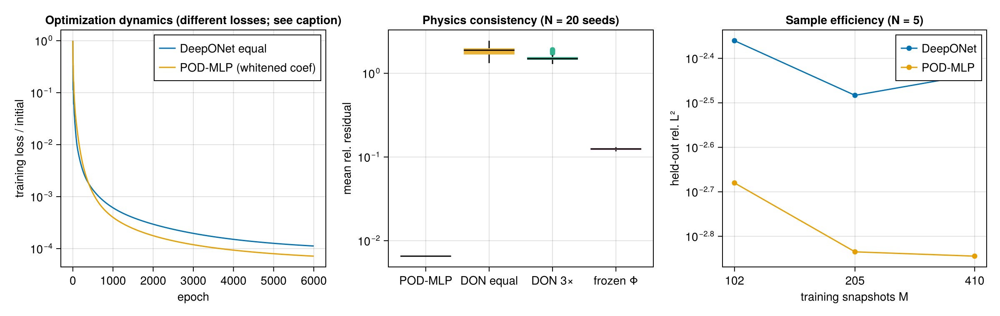

*Loss-curve overlay (normalized to initial value; the two losses differ, scaled-field
MSE against whitened-coefficient MSE, so the overlay shows optimization dynamics
only), residual ensembles per arm, and the sample-efficiency curve.*

(The parent project's exact-BC wedge does not apply here: config B has no Dirichlet
BC.)

Scope, stated to keep the comparison honest: this contest runs on the diagnostic's
yes-branch, the most favorable terrain a fixed linear basis can have, using the
operator-learning community's own implementation stack (NeuralOperators.jl) and its
own fixed-basis variant as an arm. It measures where the physics gap comes from at
matched budget on a rank-3 manifold; it is not a claim about operator learning in
general, and the no-branch (§8) points the opposite way, toward learnable dynamics.
One more fence: every arm trains on snapshots alone, so the 283× is a statement about
factorizations under a data-only loss, not about the best any DeepONet can do. A
physics-informed DeepONet changes the information budget (residual evaluations are
operator access); the reduced side's version of that upgrade is already in §7.3, the
exact Galerkin coefficients solved from the operator instead of learned from data. A
PI-DeepONet arm is the natural extension if the residual gap is ever the contested
claim.

## 8. The transient branch: same diagnosis, opposite verdict

### 8.1 Switching transients re-thicken the manifold

The transient problem drives the radiator with square-wave load cycles. The physics sets
the scales: the radiated power lags the load with the expected
$\tau_\text{rad} \approx \rho c (V/A) / 4\varepsilon\sigma T^3 \sim 10^4$ s relaxation,
a sensible regime against the 1.8–10.8 ks load periods.

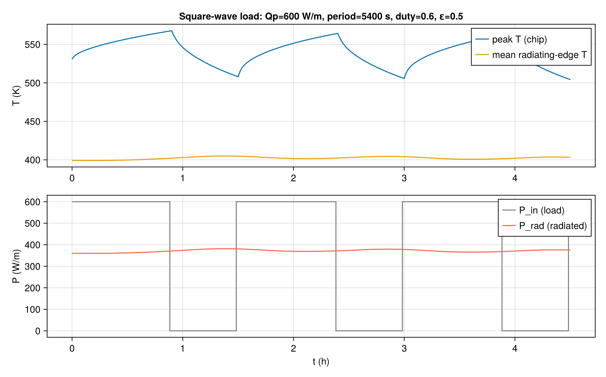

*The radiator's thermal inertia filters the 0↔600 W square wave down to a ~20 W ripple in
radiated power: the radiating edge effectively sees the orbit-average load while the chip
sawtooths over ~60 K.*

96 Sobol trajectories over $\mu = (\varepsilon, Q_p, \text{duty}, \text{period})$, three
load periods each, 61 phase-uniform states, started from the steady state at the cycle-mean
load (median transient FOM solve 13 s on the dataset-generating machine, about 270× its
steady solve; this cost asymmetry is what makes a transient surrogate worth having). The
space-time POD delivers the promised contrast to §4: instead of a rank-3 cliff, a smooth
spectrum with $\sigma_4/\sigma_1 = 6.4\cdot10^{-3}$, $\sigma_8/\sigma_1 = 3.0\cdot10^{-5}$,
$\sigma_{16}/\sigma_1 = 6.9\cdot10^{-8}$. **Switching transients re-thicken the manifold.**

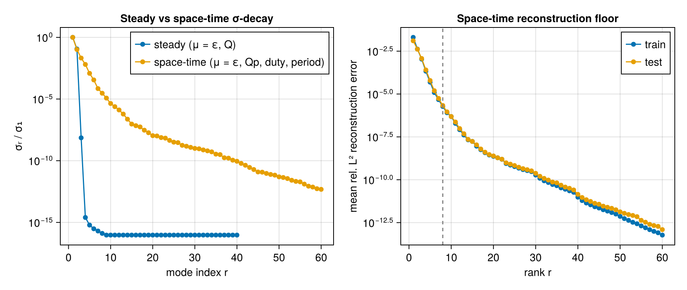

**How many modes when radiation dominates?** The scope document asked how the mode count
responds to the radiation regime. Conditioning the snapshot sets on emissivity bins (Nr
from the mean radiating-edge temperature per bin):

| ε bin | Nr (transient) | steady modes @1e-6 | space-time @1e-4 | @1e-6 |
| --- | ---: | ---: | ---: | ---: |
| [0.10, 0.38] | 0.21 | 2 | 6 | 12 |
| [0.38, 0.67] | 0.23 | 2 | 6 | 12 |
| [0.67, 0.95] | 0.27 | 2 | 7 | 12 |

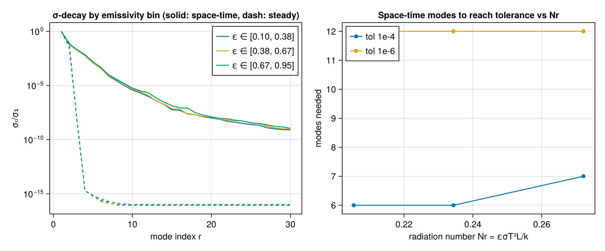

Over this parameter box the mode count grows only weakly with Nr; the dominant axis is
**steady vs transient** (2 modes vs ~6–12), not the radiation regime. The steady rank
collapse is regime-independent, confirming it is a geometry property (fixed load shape),
not a radiation property.

### 8.2 The mapper plateaus, and the plateau is data-limited

The $(\tilde\mu, t)$ mapper (inputs: 4 parameters, normalized time, two phase harmonics;
128×3 MLP) uses *capped* whitening: full whitening would upweight $\sigma_8$-level modes by
~3·10⁴ and the net burns its capacity on unlearnable switching detail, so the scales are
floored at 1% of $\sigma_1$.

| $r$ | traj rel L² | POD floor |
| ---: | ---: | ---: |
| 4 | 1.69e-2 | 2.5e-4 |
| **8** | 1.74e-2 | 2.1e-6 |
| 16 | 1.76e-2 | 1.1e-8 |
| 32 | 1.45e-2 | 1.2e-10 |

The sweep is *flat*: the mapper, not the basis, is the binding constraint. This is the steady
lesson in mirror image (there the basis was five orders better than needed; here it is four
to eight).

**Why the plateau (diagnosed, `scripts/17_mapper_diagnostics.jl`).** Two measurements pin it
down. The learning curve is steep: 24 → 48 → 77 training trajectories give errors
5.2e-2 → 3.0e-2 → 1.8e-2, slopes 0.82 and 1.10 in $M$ (near $M^{-1}$, far steeper than the
statistical $M^{-1/2}$). The plateau is therefore **data-limited, not basis-limited**: more
trajectories would buy accuracy directly. The per-mode view shows the same signal-to-noise
collapse as the parent project: modes 1–4 are learned to 7–22% relative error, mode 6 to
87%, and modes 7–8 are pure noise (relative error > 1), which is exactly why the rank sweep
is flat.

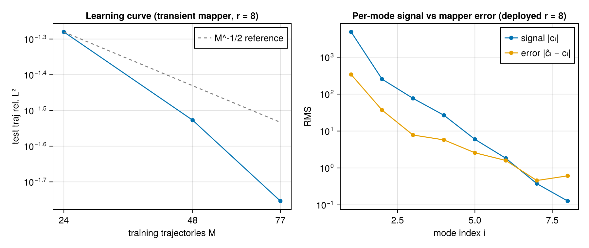

QoI tracking at the deployed $r=8$ (N = 19 held-out trajectories): peak-temperature error
median 14.3 K / max 42.6 K along trajectories; radiated-power tracking error median 14% /
max 39%. The worst case is
instructive: it is the *low-load* corner ($Q_p = 136$ W/m), where the true
$P_\text{rad} \approx 94$ W is nearly constant because the radiator's thermal inertia filters
the square wave almost completely, so a small absolute error is large relative to the local
signal. On design-relevant loads the same surrogate ranks designs almost perfectly (§9.2).

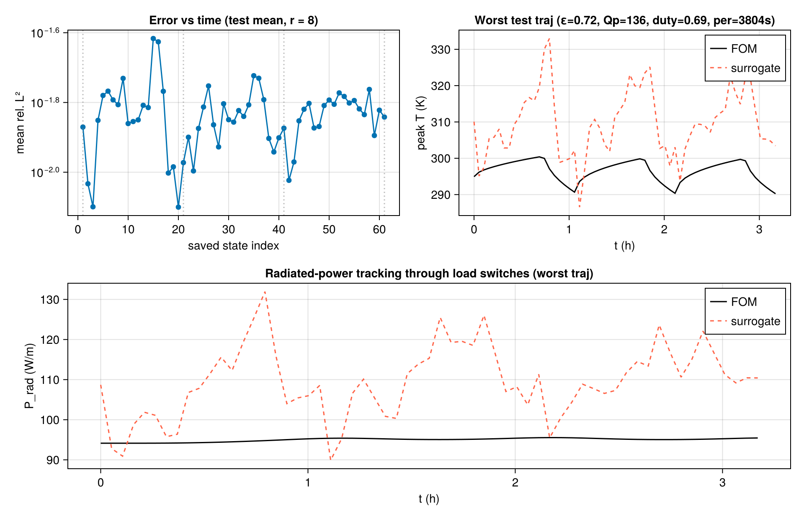

*Error vs time, peak-temperature trace, and radiated power vs time for a load cycle
(surrogate vs FOM), shown for the worst held-out trajectory.*

### 8.3 Verdict and exits

This is the flowchart's no-branch, reached with measurements in hand. The manifold is not
intrinsically low-dimensional at the accuracy the steady problem enjoys; the basis is four
to eight orders better than the map at every rank; and the binding constraint is data
(learning-curve slopes near $M^{-1}$). At this data budget, $(\mu, t) \mapsto c$
regression is not the right factorization: it works to 1.7%, and its own diagnostics say
which exits exist. In the order the measurements license them: a larger trajectory budget
(the near-$M^{-1}$ slope pays directly), and latent *dynamics*, learning
$\dot c = f(c, \mu, \text{load}(t))$ through the solver instead of regressing $c(t)$
against time (§11; the load switches make the training problem stiff). More modes is
measurably not an exit.

What survives the plateau is ranking. The 1.7% surrogate still orders designs almost
perfectly, which is the engineering result the next section quantifies.

## 9. Engineering consequences

### 9.1 Timing: latency vs throughput

BenchmarkTools medians, batch size = 102. Speed-ups are batched throughput over FOM Newton
solves, including POD reconstruction (and unscaling for the direct model), excluding plotting
and model loading, after warm-up; the FOM reference is the full Newton solve described in §3.
*Hardware, for every timing in this report:* AMD Ryzen
AI 9 HX 370 (CPU only; the iGPU is unused), 1 Julia thread, 12 BLAS threads, Julia 1.12.6,
re-measured 2026-07-09. The frozen data artifacts were generated on earlier hardware,
whose dataset log shows a median 49 ms Newton solve (§4); all timings quoted here are
from the current machine.

| method | single (ms) | batched (ms/q) | single× | batched× | allocs (1-q) |
| --- | ---: | ---: | ---: | ---: | ---: |
| FOM solve | 23.1 | — | 1× | — | 188,945 |
| direct MLP | 0.013 | 0.0032 | 1,796× | 7,259× | 22 |
| POD-MLP | 0.004 | 0.0026 | 5,270× | 8,852× | 31 |
| POD-KAN | 0.006 | 0.0025 | 4,159× | 9,104× | 90 |

The 10³–10⁴× factors are larger than the parent's because the FOM is now a nonlinear solve;
that is the honest framing: surrogate value grows with FOM cost. The headline of the method
remains the structure (rank-2 basis, physics metrics), not the raw speed-up.

### 9.2 Design ranking at throughput

The capstone reproduces the project's stated success criterion, a tool for testing subtle
design changes. Candidate designs: a 10×10 grid over emissivity coating ε ∈ [0.15, 0.9] and
load duty ∈ [0.25, 0.75]; QoI = worst-case chip temperature over the final (settled) load
cycle. Two operating points guard against the result being a one-off.

| | OP1: $Q_p$=650 W/m, 5400 s | OP2: $Q_p$=400 W/m, 9000 s |
| --- | ---: | ---: |
| FOM sweep (100 candidates) | 390 s | 390 s |
| surrogate sweep | 1.77 s (incl. Julia JIT) | **0.048 s** (warm) |
| throughput | 221× | ≈8,100× |
| QoI error | median 2.4 K, max 16.5 K | median 2.2 K, max 16.8 K |
| QoI range | 382–785 K | 320–645 K |
| Spearman rank correlation | **0.9987** | **0.9988** |
| top-5 designs recovered | **5 / 5** | **5 / 5** |
| best design | identical (ε=0.90, duty=0.25) | identical (ε=0.90, duty=0.25) |

The throughput asymmetry is compilation, reported rather than hidden: the first sweep pays
Julia's JIT once; warm sweeps cost ~0.05 s for 100 candidates. The conservative end-to-end
number is 221×; the warm number is the deployment-relevant one. The FOM reference these
errors are measured against is itself solid: the steady GCI study (A.2) bands the
deployed grid's discretization error on peak temperature at 0.005–0.010 K, and the
transient reference is integrator-tolerance-controlled (§3), both far below the
2.2–2.4 K median surrogate QoI error quoted here.

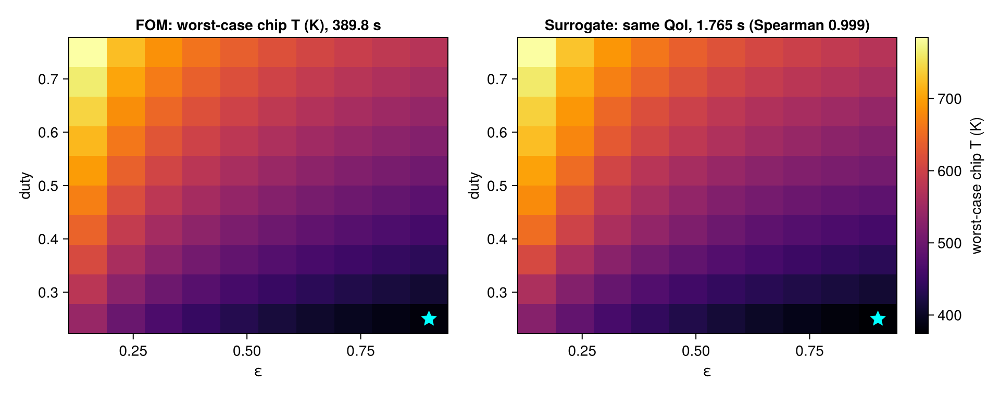

*Worst-case chip temperature over a 10×10 (ε, duty) grid. The surrogate reproduces the FOM
ranking with Spearman correlation 0.999 at over 220× higher throughput (≈8×10³× warm), with
the same best design point (star).*

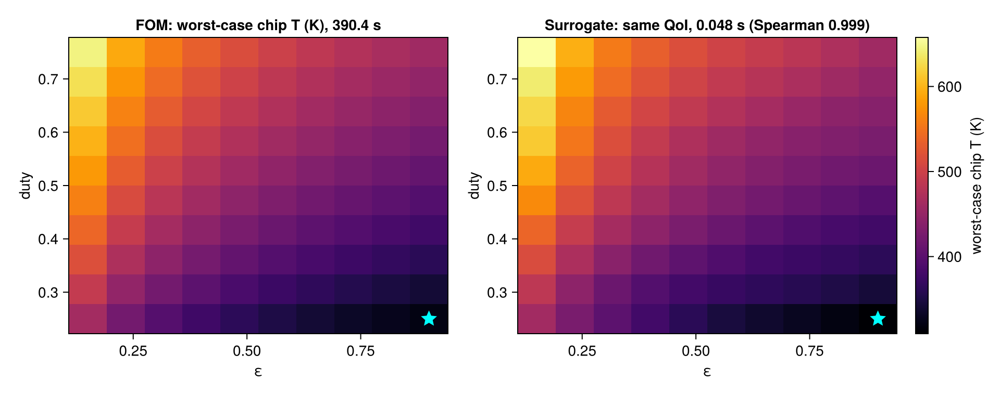

The claim defended is deliberately *ranking fidelity*, not pointwise truth: a screening tool
must order candidates correctly and hand the shortlist to the full-order model, which this
one does, in-distribution, with margin.

### 9.3 The deployment contract

This surrogate ships with four measured clauses; the machinery behind each lives in Appendix A.

**Stay in the box.** Outside the training box the surrogate degrades *fast*, and
measurably: on 60 points in a physically sensible ring (ε down to 0.02, Q up to
1000 W/m), the median error grows from 7.0e-4 in-box to 1.2e-2, with a worst case of
19.5% at only 9% normalized exceedance. `in_training_box(ε, Q)` in `scripts/config.jl`
is the guard; screen inside the box, hand anything near the boundary to the FOM (A.1).

**The settled-cycle clause.** The design QoI reads cycle 3 of a 3-cycle run as "the
settled cycle". A 20-cycle FOM check at two points (A.4): the FOM settles geometrically
(cycle-to-cycle change 0.028/0.022 K by c19→20); the surrogate's settled-cycle deviation
stays flat within 1.41× of its cycle-3 value; and the measured qualification is that
cycle 3 itself sits 1.4–3 K short of the true attractor. That bias is shared by the FOM
sweep and the surrogate in the design study (both read cycle 3), so rankings are
unaffected, but absolute worst-case temperatures quoted at "the settled cycle" carry it.
Normalized time $\tau > 1$ is out of distribution and guarded, the same way
`in_training_box` guards the steady box.

**Arithmetic.** Float32 inference is lossless at every reported digit; Float16 inference
survives (rel L² 1.06e-3, ~1 K worst-case field drift), but any $u^4$ evaluation
overflows Float16 at $T \ge 16.0$ K, i.e. at 100% of operating temperatures, so the
physics-residual check and any QoI integrand containing $u^4$ must run in Float32 or
wider (A.3). An 8,642-parameter Float32 model fits edge hardware the FOM never will.

**Many-query readiness.** Forward UQ through the surrogate propagates N = 100,000
scenarios in 7.5 s; against an exact 10,000-solve FOM Monte Carlo on the same sample
stream, every reported quantile agrees within 0.71 K (paired; A.5). The per-sample cost
sits ~590× below the FOM's (44 ms against 75 µs).

### 9.4 Interactive console

`scripts/14_run_console.jl` (GLMakie) solves the steady FOM *live* while you drag
$(\varepsilon, Q)$; a ~23 ms Newton solve (§9.1) is interactive. Next to it sit the surrogate's
prediction, the error field, QoI readouts, and both σ-spectra; the transient panel updates
the surrogate's peak-temperature trace instantly and overlays the true FOM trajectory on
demand. `CONSOLE_SMOKE=1` renders the same layout headlessly for CI. The console is a
scoping or calibration tool, not the science.

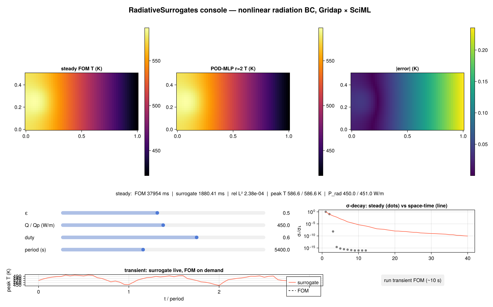

## 10. Discussion

**What the two branches demonstrate.**
1. The right-basis thesis survives contact with a strongly nonlinear BC, and it sharpens:
   for fixed load geometry the steady manifold is rank-2/3 with *all* nonlinearity in
   $c(\mu)$, the best possible case for coefficient mappers and one that intrusive methods
   would still have to hyper-reduce their way through. The transient branch shows the
   diagnosis discriminates: same physics, opposite verdict, measured reason.
2. Physics metrics do the discriminating. L² errors of the direct and reduced surrogates
   differ by ~6×; their PDE residuals differ by ~6,000×. Reporting only L² would hide what
   matters.
3. The surrogate preserves design rankings (worst-case temperature) at over two orders of
   magnitude higher throughput end-to-end, making it a practical screening tool inside
   many-query design loops, in-distribution; batched steady field queries reach 10³–10⁴×.
4. A methodological marker: a non-intrusive ROM of a strongly nonlinear-BC problem, with
   an exact Galerkin error decomposition and pre-registered diagnostics, assembled from
   general-purpose open tooling in an afternoon of glue code. Ten years ago this was a research project in itself: the standard path was an intrusive Galerkin ROM with hand-built hyper-reduction per nonlinearity (DEIM). That it is now routine is a credit to the
   cited FE and solver ecosystems (Badia & Verdugo 2020; Pal et al. 2024; Rackauckas &
   Nie 2017).

**What the verification pass produced beyond its verdicts.** Three structural identities
in one family: the exact discrete energy balance (§2), $P_\text{rad}$ grid-exact to
1.6e-12 as its corollary, and the mean radiating-edge temperature nodally pinned to
1.0e-13 by an exact 1D reduction of the y-summed Q1 system (A.2). A pre-registered
Float16 overflow prediction that missed in the surrogate's favour (A.3). And the
settled-cycle bias, measured at 1.4–3 K and shown to cancel in rankings (A.4).
The verification is what licenses the verdicts in both directions: the machinery that
certifies the steady *yes* is exactly what makes the transient *no* a measurement rather
than a failure to try.
**Caveats.** 2D, fixed geometry, unity view factor (deep space only), constant properties,
effective (not measured) $\rho c$, in-distribution queries only (measured: median error
grows ~17× just outside the training box, worst ~20% at 9% exceedance; A.1), and a single
PDE family: a controlled prototype, not a general theorem. The steady rank-3 result is a property of the
fixed load geometry, not of radiation physics; parametric load *placement* would re-thicken
the steady manifold (future work).

**V&V status (ASME V&V 20 vocabulary).** A terminology note first: every comparison in
this report is *verification*, a computation checked against a more trusted computation
or an exact structural identity; *validation* would require physical measurement, which
this prototype does not attempt. The tiers:

| tier | evidence | status |
| --- | --- | --- |
| code verification | MMS through the nonlinear BC, observed L² orders 1.9996–2.0000 (§3); nodally exact 1D radiative equilibrium | complete |
| solution verification | exact discrete energy balance (measured ~1e-10, §3); nonlinear residual metric on every prediction (§7.1); grid-convergence (GCI) error bands on the FOM QoIs (A.2) | complete |
| surrogate verification | held-out errors, rank sweeps, N = 20 seed ensembles, measured OOD degradation, exact Galerkin floor (§7, A.1); note surrogate-vs-FOM is verification, not validation | complete |
| model validation | **unaddressed by design**: 2D section, unity view factor, fixed 3 K deep-space sink, effective ρc; no comparison against measurement or a 3D code | open |
| uncertainty quantification | forward UQ over (ε, Q) with an exact FOM Monte Carlo reference (A.5) | complete |

The named model-form gap: $T_\text{space}$ is fixed at 3 K (deep space); in LEO,
Earth-shine and albedo raise the *effective* sink temperature to roughly 250 K, which
shifts absolute temperatures. The surrogate is trained at fixed $T_\text{space}$, so this
is a model-form limitation to re-train against, not a random input to sample (the 3 K
sink term itself is numerically irrelevant, $T_s^4/u^4 \le 10^{-8}$ over the box). A 3D
cross-code benchmark is declined on purpose: it would test model form, not this study's
claims, and MMS is the stronger code-verification instrument; the fin-model variant in
future work is the natural home for one.

## 11. Future work

The operator-learning baseline has run (§7.4: two hits, two instructive misses). First,
the exit §8.3 licenses: latent dynamics for $c(t)$, learning
$\dot c = f(c, \mu, \text{load}(t))$ through the solver instead of the $(\mu, t)$
regression, as a neural ODE / UDE on the coefficients or as operator inference on the
reduced system (Peherstorfer & Willcox 2016); the load switches make the training
problem stiff, so the crux is adjoint gradients through a stiff integrator. Then:
thin-plate fin variant (radiation as a volumetric $2\varepsilon\sigma(u^4 - T_s^4)/t$
sink; same Newton machinery); parametric load geometry; view factors and orbital
environment (solar/albedo as boundary sources); full DEIM for online reduced-Galerkin;
residual-informed training; unstructured GridapGmsh geometries; 3D;
mass-matrix-weighted POD.

## Appendix A. Verification machinery

Sorting rule for what lives here: checks whose failure would flip a conclusion are cited
inline in the section that rests on them; their machinery and full tables sit in this
appendix. Every number is regenerated by the numbered scripts and reprinted from the
frozen artifacts by `scripts/18_report_numbers.jl`.

### A.1 Seed ensembles, out-of-distribution behaviour, statistics

Are the headlines one lucky seed? Twenty fresh training seeds per deployed mapper
(`scripts/15_robustness.jl`; deployed models keep their rank-keyed seeds, the ensemble is
reported, not deployed). The seeds vary the network parameter initialization **only**:
training is full-batch Adam on the fixed Sobol dataset with a deterministic learning-rate
schedule, so there is no minibatch or data-draw stochasticity to vary.

| mapper | deployed | ensemble mean ± std (N = 20) | ensemble [min, max] |
| --- | ---: | ---: | ---: |
| POD-MLP r=2 | 9.18e-4 | 1.35e-3 ± 0.18e-3 | [9.69e-4, 1.67e-3] |
| POD-KAN r=2 | 2.92e-3 | 2.86e-3 ± 0.49e-3 | [1.90e-3, 3.56e-3] |
| POD-MLP-t r=8 | 1.74e-2 | 1.89e-2 ± 0.20e-2 | [1.53e-2, 2.25e-2] |

Every conclusion survives every seed: the ordering (MLP < KAN, both ≪ direct), the r=2
optimum, and the transient plateau. One transparency note: the deployed steady MLP sits
at the favourable edge of its ensemble, below all 20 fresh seeds, which stay within 1.9×
of it; the ensemble mean 1.35e-3 ± 0.18e-3 is the fair "typical seed" number, and the
README quotes it alongside the headline.

Outside the training box the surrogate degrades *fast*, and now measurably: on 60 points in
a physically sensible ring (ε down to 0.02, Q up to 1000 W/m), the median error grows from
7.0e-4 in-box to 1.2e-2, with a worst case of 19.5% at only 9% normalized exceedance.
`in_training_box(ε, Q)` in `scripts/config.jl` is the guard; the honest usage contract is:
screen inside the box, and hand anything near the boundary to the FOM.

**Confidence intervals and ablations** (`scripts/20_statistics.jl`; 10,000-resample
bootstraps, StableRNG(SEED+9000)). Design-ranking Spearman: 0.9984 [0.9960, 0.9994] at
OP1 and 0.9983 [0.9965, 0.9992] at OP2 (N = 100 designs each). Paired per-sample
differences on the same 102 test parameters: KAN − MLP = +2.0e-3 [1.6, 2.4]e-3 and
direct − MLP = +4.9e-3 [4.4, 5.4]e-3 rel L²; both intervals exclude zero, so the model
ordering is not seed luck. Ablations at r = 2: turning whitening **off** (same seed)
degrades the mapper 200× to 2.1e-1, and swapping in a random orthonormal basis caps
accuracy at exactly its own projection floor (2.13e-1): whitening is load-bearing and the
basis choice sets the ceiling. The full StableRNG seed table is printed by the script and
in `data/statistics.jld2`.

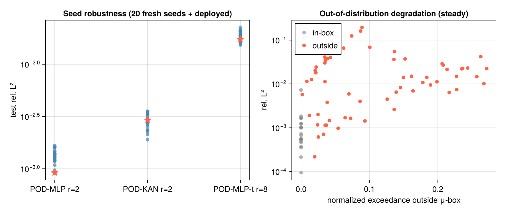

### A.2 Grid-convergence error bars on the FOM (GCI)

How much of the "FOM truth" is discretization error? Three systematically refined grids
(60×30 / 120×60 / 240×120, ratio 2), five Sobol $(\varepsilon, Q)$ points, safety factor
$F_s = 1.25$ (`scripts/24_gci.jl`; predictions pre-registered in the script header, two
rounds, misses kept). The smooth QoIs converge at exactly the code-verification order:
the hot-node probe temperature (a fixed vertex of all three grids, equal to the reported
$T_\text{peak}$ on the deployment grid) shows observed order $\hat p = 1.99$ at all five
points, and $\|u_h\|_{L^2}$ shows $\hat p = 2.00$ (N = 5 each). Richardson banding puts
the **deployment-grid discretization error of the peak temperature at median 0.005 K,
max 0.010 K**: roughly 500× below the surrogate's 2.4 K median design-QoI error (§9.2),
so the reference the surrogate is judged against is nowhere the limiting error.

The pre-registered round-1 scorecard: one hit, two instructive misses.
$P_\text{rad}$ is grid-exact as predicted (worst $|P_\text{rad} - Q|/Q = 1.6\cdot
10^{-12}$ over 15 solves): the chip patch is face-aligned on all three grids and the
discrete energy balance holds on each, so there is no discretization error to measure.
The other two round-1 QoIs missed the predicted $\hat p \in [1.7, 2.2]$ band, each for a
structural reason. The raw nodal-max $T_\text{peak}$ converges *non-monotonically* (−33
then +1 mK between refinements): the argmax node drifts under refinement, a max is not a
smooth functional of $h$, and Richardson does not apply to it; the fixed-probe form is
the correct banding target. And the mean radiating-edge temperature shows no measurable
grid dependence at all (worst coarse-vs-fine deviation $1.0\cdot10^{-13}$): on this
tensor-product Q1 grid the $y$-summed discrete system reduces exactly to a 1D problem
whose data (the $y$-integrated load and the exactly balanced edge flux) are
grid-independent, pinning the edge mean nodally. A third structural identity in the same
family as the discrete energy balance. Transient GCI is deferred: the transient
reference is integrator-tolerance-controlled (§3) and is not banded here.

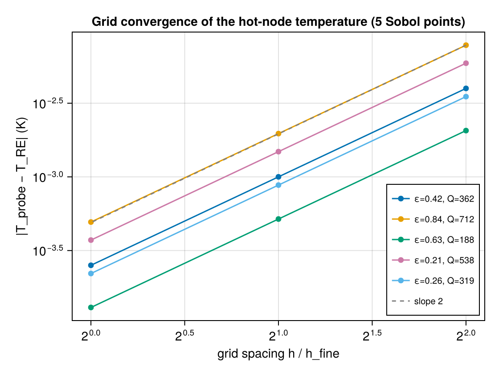

### A.3 Precision audit: what arithmetic does deployment need?

Casting the entire steady inference pipeline (inputs, network weights, whitening scales,
POD mean and modes) to reduced precision and re-evaluating the 102-sample test set
(`scripts/25_precision_audit.jl`; predictions pre-registered in the script header):

| pipeline | rel L² | max ΔT_peak (K) | max field drift vs F64 (K) |
| --- | ---: | ---: | ---: |
| Float64 | 9.1757e-4 | 3.56 | — |
| Float32 | 9.1757e-4 | 3.56 | 1.3e-4 |
| Float16 | 1.0586e-3 | 3.37 | 1.07 |

Float32 is lossless at every reported digit, as pre-registered. The Float16 prediction
**missed, in the surrogate's favour**: we predicted overflow at reconstruction
(coefficient scale against the 65,504 Float16 ceiling), but the whitening scales are
$4.97\cdot10^3$ and $5.71\cdot10^2$, every intermediate stays finite, and the Float16
pipeline still delivers rel L² 1.06e-3 with ~1 K worst-case field drift: usable,
marginally degraded. What does fail in Float16, exactly as pre-registered: any $u^4$
evaluation overflows for $T \ge 65504^{1/4} \approx 16.0$ K, i.e. at 100% of operating
temperatures. Edge-compute reading: field *inference* is Float32-safe (even
Float16-tolerant at the $10^{-3}$ level), but the physics-residual check and any QoI
integrand containing $u^4$ must run in Float32 or wider.

### A.4 Attractor check: 20 cycles against the 3-cycle deployment contract

The design QoI (§9.2) reads cycle 3 of a 3-cycle run as "the settled cycle". The mapper
is feedforward in $(\mu, \tau, \text{phase})$, so autoregressive drift is structurally
impossible; what could fail is the contract itself. Two parameter points, FOM run to 20
cycles, surrogate predicting its fixed settled-cycle trace by phase mapping
(`scripts/26_attractor_check.jl`; N = 2, predictions pre-registered in the script
header; $\tau > 1$ is never queried, it is OOD by the deployment contract):

- **FOM settling (pre-registered, hit).** The cycle-to-cycle peak-T trace change decays
  geometrically at both points: 22.4 K (c1→2) → 0.34 K (c9→10) → 0.028 K (c19→20), and
  15.3 → 0.29 → 0.022 K, under the registered 0.5 K-by-cycle-10 and 0.05 K-at-19→20
  bounds.
- **Deviation flatness (hit on the registered 2× bound, with one measured
  qualification).** The per-cycle deviation between the surrogate's fixed settled-cycle
  trace and FOM cycles 3–20 stays within [0.81, 1.41]× and [0.84, 1.13]× of its cycle-3
  value (7.4 K and 10.2 K, consistent with the §8.2 error level). It is not constant,
  though: it rises by +3.0 K and +1.4 K before saturating, and the rise tracks the FOM's
  own settling tail exactly. Read structurally: the training data's cycle 3 sits 1.4–3 K
  short of the true attractor at these points. That bias is shared by the FOM sweep and
  the surrogate in the design study (both read cycle 3), so rankings are unaffected, but
  absolute worst-case temperatures quoted at "the settled cycle" carry it.

The deployment contract, now explicit and measured: phase features are valid on (or
near) the attractor; normalized time $\tau > 1$ is out of distribution and guarded, the
same way `in_training_box` guards the steady $(\varepsilon, Q)$ box.

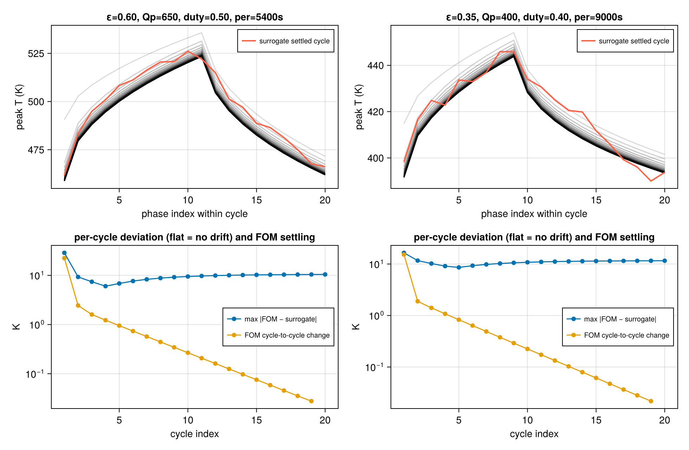

### A.5 Forward UQ with an exact FOM reference

Input uncertainty, stated here and used nowhere else: $\varepsilon \sim
\mathcal N(0.85, 0.02)$ (coating tolerance around a high-emissivity design point) and
$Q \sim \mathcal N(600, 50)$ W/m (load uncertainty), both truncated to the training box
by rejection (acceptance 1.0000 each; 100,000 / 100,000 samples pass `in_training_box`
by construction). QoI: steady worst-case (peak) temperature
(`scripts/27_forward_uq.jl`; StableRNG(SEED + 2700); predictions pre-registered in the
script header). The surrogate propagates N = 100,000 samples in 7.5 s warm; the exact
FOM reference is N = 10,000 Newton solves (444 s, warm-started, median 44 ms/solve) on
the *first 10,000 points of the same sample stream*, so the surrogate-vs-FOM deltas
below are paired and carry no Monte Carlo noise:

| quantile | FOM (N = 10⁴) | surrogate, paired (N = 10⁴) | Δ paired (K) | surrogate (N = 10⁵) |
| ---: | ---: | ---: | ---: | ---: |
| 50% | 616.49 | 616.27 | −0.22 | 616.44 |
| 90% | 649.51 | 649.36 | −0.15 | 650.24 |
| 99% | 678.24 | 678.93 | +0.68 | 678.68 |
| 99.7% | 690.66 | 691.36 | +0.71 | 689.10 |

Pre-registered: every paired quantile delta under 4 K (the steady surrogate's max
peak-T error over the test box). Measured: $|\Delta| \le 0.71$ K at every reported
quantile, pointwise paired error median 0.29 K, max 0.86 K (N = 10,000), an order of
magnitude inside the registered bound. The 3σ statement a designer would use: the 99.7%
quantile of worst-case temperature is 690.7 K by FOM against 689.1 K by the surrogate at
N = 10⁵, and the paired column shows only +0.7 K of that gap is surrogate error; the
rest is FOM-side Monte Carlo noise in a thin tail at N = 10⁴. For tail quantiles the
surrogate's N = 10⁵ estimate is the better-converged one, at a per-sample cost ~590×
below the FOM's (44 ms against 75 µs). $T_\text{space}$ stays fixed at 3 K throughout: a
model-form limitation
(§10), not a random input; re-training at an Earth-shine effective sink, not sampling
the sink, is the correct treatment.

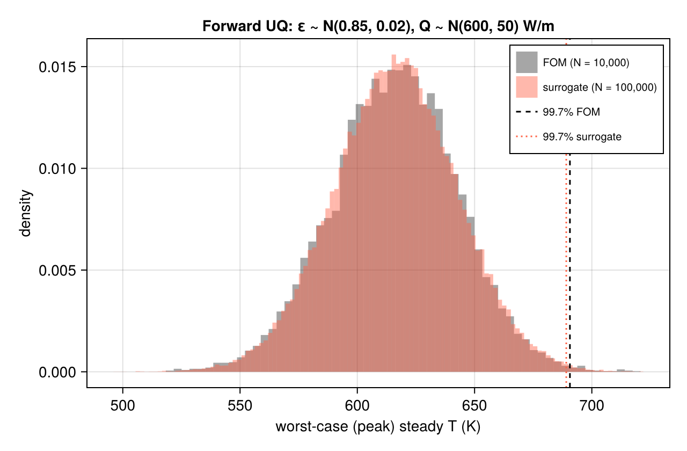

## References

- Gridap: Badia & Verdugo, *Gridap: An extensible FE toolbox in Julia*, JOSS 2020.
- NonlinearSolve.jl / OrdinaryDiffEq.jl: Pal et al. 2024; Rackauckas & Nie 2017.
- Reduced-basis methods: Quarteroni, Manzoni & Negri, *Reduced Basis Methods for PDEs*, 2016.
- DEIM: Chaturantabut & Sorensen, SIAM J. Sci. Comput. 2010.
- DeepONet: Lu, Jin, Pang, Zhang & Karniadakis, Nat. Mach. Intell. 3, 218–229, 2021.
- Operator-learning comparison methodology and POD-DeepONet: Lu, Meng, Cai, Mao,
  Goswami, Zhang & Karniadakis, Comput. Methods Appl. Mech. Eng., 2022
  (arXiv:2111.05512).
- Operator inference: Peherstorfer & Willcox, Comput. Methods Appl. Mech. Eng. 2016.
- Parametric regularity and widths: Cohen, DeVore & Schwab, Anal. Appl. 2011; Cohen &
  DeVore, IMA J. Numer. Anal. 2016; Lassila, Manzoni, Quarteroni & Rozza 2013; Bachmayr &
  Cohen, Math. Comp. 2017; Chkifa, Cohen & Schwab, J. Math. Pures Appl. 2015.
- Nonlinear/compressive reduced bases (linear width vs intrinsic dimension):
  Prud'homme, Maday & Ballout, arXiv:2407.03769, 2024; Cohen, Dolbeault, Somacal &
  Dahmen, arXiv:2304.10971, 2023.
- Kolmogorov–Arnold networks: Liu et al., 2024; `KolmogorovArnold.jl`.
- Parent project: [TommyDanMa/reduced-basis-neural-surrogates](https://github.com/TommyDanMa/reduced-basis-neural-surrogates),
  *Learning PDE Solution Operators in the Right Basis* (report in `report/report.md` there).
